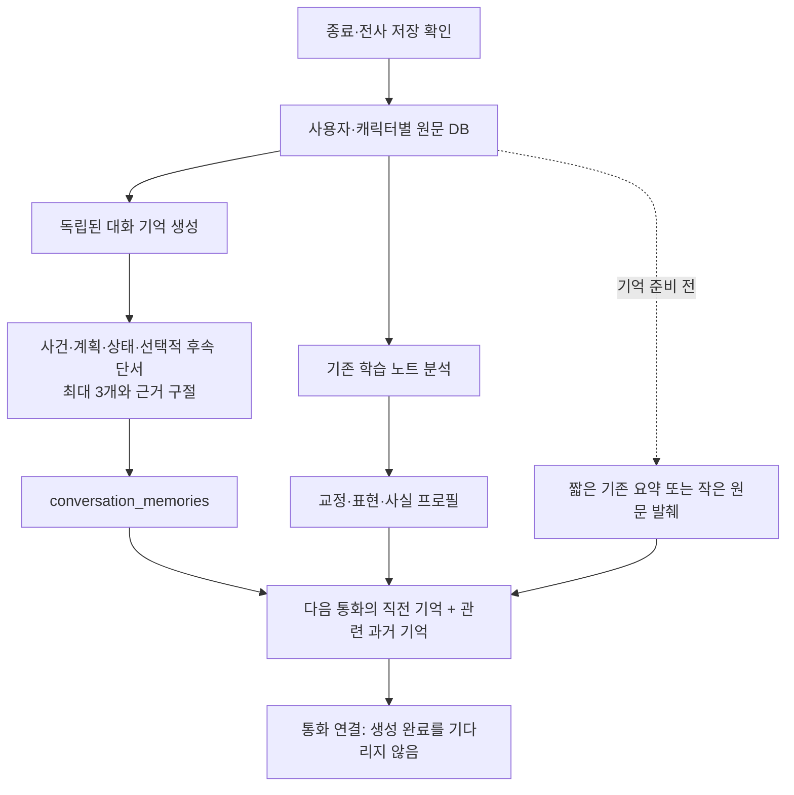
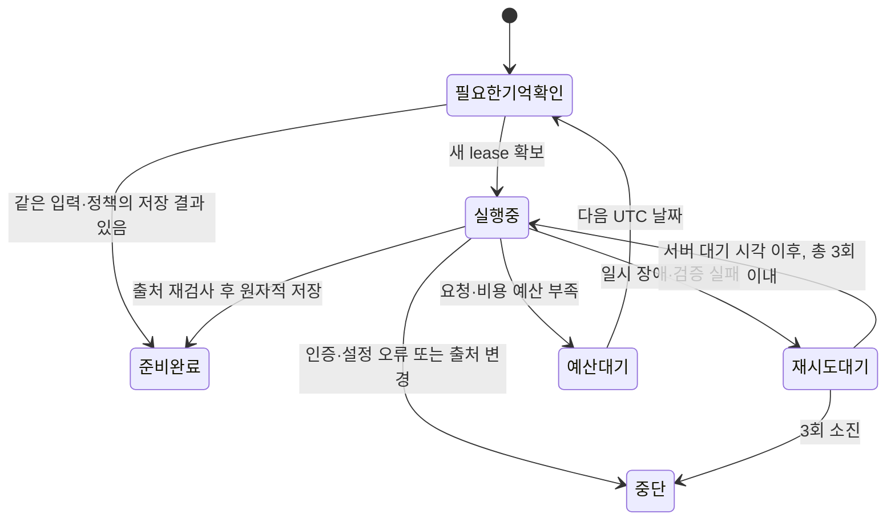

# 시시콜콜의 대화 기억과 실패 복구

## 제품 기준

시시콜콜은 같은 AI 상대와 일상을 이어 말하면서 영어로 의도를 전달하고 반응하는 연습을 하는 전화형 서비스다. 다음 날 같은 상대에게 다시 설명해야 하는 경험, 계획을 이미 끝난 일로 취급하는 반응, 과거 표현을 잘못 인용하는 반응을 줄이는 것이 기억 설계의 목적이다. 저장 성공이나 검색 테스트 통과를 실제 회상 품질 또는 학습 효과로 해석하지 않는다.

대화 기억에는 사건·계획·미해결 이야기의 상태가 필요하다. 사용자 사실 프로필에는 직접 수정·잊기가 필요하고, 학습 표현에는 실제 원문과 별도 학습 상태가 필요하다. 하나의 자유 형식 피드백 요약으로 이 역할을 모두 충족시키지 않는다.

## 구현한 구조

`memory-prepare`는 별도 `handoff` 작업으로 실행한다. 학습 노트 결과를 조회하거나 그 성공을 기다리지 않는다. 저비용 모델 `gpt-6-luna`가 통화 전체를 한 번 읽고 중요 내용을 고른다. `MEMORY_MODEL`과 `MEMORY_REASONING`은 기존 분석 설정과 독립적이며 출력 상한은 1,800토큰이다. 입력 한도를 넘는 통화를 몰래 잘라 요약하지 않고 중단한다.

각 기억에는 짧은 설명, `stated / planned / resolved / unknown`, 원문에 있는 시간 표현 또는 null, 선택적 후속 대화 단서, 실제 사용자 발화 ID 한 개와 원문 구절을 둔다. 기억은 최대 3개, 구절은 각각 180자, 저장 전 JSON은 2,800바이트 이하로 제한한다. 발화 ID·발화자·원문 부분 문자열·시간 표현을 검증하지만 요약의 의미가 정확한지까지 자동 입증하지는 않는다. 조언·역할극·민감정보·발화로 확인하지 못한 수준·상태·완료를 기억으로 추출하지 않도록 지시한다.

저장은 학습 노트와 별도 테이블에 한다. 원문 버전과 기억 정책 revision, 생성 정책 해시를 연결한다. 생성 중 지연 전사·복원으로 입력이 바뀌거나 제외·잊기·품질 보류가 생기면 옛 결과는 저장할 수 없다. 계정 승인 상태도 다시 검사한다. 일반 사용자에게 테이블이나 서비스 RPC를 직접 공개하지 않는다. 파생 기억은 원문 삭제 시 함께 삭제되며 백업에서는 원문으로 재생성한다.

다음 통화에는 직전의 유효한 대화 기억을 우선 전달한다. 다른 과거 대화 기억은 키워드 관련성·최근성으로 최대 4개를 고르고, 직전 회차와 중복을 없앤다. 이 경로는 현재 임베딩 검색이 아니다. 기존 학습 분석 검색의 혼합 검색은 유지한다. 새로운 대화 기억이 들어간 회차의 기존 피드백 문맥은 제거해 같은 이야기를 중복 주입하지 않는다. 사실 프로필과 서비스가 허용한 학습 표현은 별도 경로를 유지한다.

대화 기억 한 묶음은 메타데이터 포함 4,000바이트, 직전·과거 대화 기억 묶음은 6,500바이트 이하다. 기존 전체 데이터 문맥 20,000바이트 한도 안에서 오래된 피드백 문맥, 추가 과거 대화 기억 순으로 줄인다. 바이트 제한은 실제 토큰 수나 최적 비용을 측정한 결과가 아니다.

아직 대화 기억이 없는 회차는 유효한 기존 분석 요약 최대 600자와 사용자 근거 한 개를 사용한다. 그마저 없으면 통화 전체에서 계획 단서·내용 길이를 기준으로 사용자 발화 최대 2개, 각각 180자를 임시 선택한다. 끝인사 12개를 계속 동봉하던 방식은 제거했다. 이 임시 선택은 의미 검색이 아니며 중요한 내용을 반드시 고른다는 보장은 없다.

## 구현한 재처리

| 실패 | 현재 처리 |
| --- | --- |
| 429·5xx·전송 실패·불완전 출력 | 같은 모델로 최대 3회. 기본 30초·120초 대기, 429의 숫자 `Retry-After`도 반영(최대 900초) |
| 원문 인용·ID·시간 표현 검증 실패 | 검증을 완화하지 않고 제한된 재생성. 다음 시도에 더 적은 기억과 정확한 인용을 요구 |
| 401·403 등 제공자 설정 오류 | 자동 반복 중단. 설정 복구를 확인한 뒤 운영자가 재개를 검토해야 하며, 키 수정만으로 기존 작업의 제한을 자동 초기화하지 않음 |
| 일일 요청·금액 예산 부족 | 다음 UTC 00시, 한국 09시까지 대기. 생성 시도 횟수 소진으로 세지 않음 |
| 원문·기억 정책 변경 | 이전 키의 작업 중단. 새 입력·정책은 새 키로 처리 |
| 응답 유실·화면 새로고침·동시 탭 | 완료 결과 재사용. 실행 중 lease가 있으면 새 모델 호출을 하지 않음 |
| 실행 중 프로세스 종료 | 120초 lease 만료 뒤 제한된 재확보. 이전 작업자는 새 lease로 결과를 저장할 수 없음 |
| 입력 용량 초과·유효한 출처 없음 | 자동 반복 중단. 부분 입력으로 정상 기억을 가장하지 않음 |

시도 횟수·다음 시각·중단 여부는 서버 `analysis_jobs`에 저장된다. 새 탭이나 기기에서 횟수를 초기화할 수 없다. 완료 기억·완료 작업은 같은 트랜잭션에서 확정한다. 금액 예약은 기존 모든 텍스트 작업의 사용자별 UTC 일일 1달러 예약 한도를 공유하고, 기억 작업에는 별도 일일 30회 요청 한도를 둔다. 예약 한도는 제공자 청구서의 강제 상한이 아니다. 전송 결과를 모르는 요청은 이미 과금됐을 가능성을 고려해 예약을 보수적으로 남긴다.

통화 종료 후와 기록 로드 시 앱이 최근의 유효한 통화를 확인한다. 통화 중에는 생성을 시작하지 않고 미룬다. 통화 연결은 기억 생성 완료를 기다리지 않는다. 앱이 열린 동안 서버 재시도 시각을 따라 재요청하고, 다시 로그인하거나 기록을 열면 각 캐릭터의 최신 유효 통화에서 복구한다. **앱을 닫아 둔 동안 실행하는 서버 스케줄러는 이번 구현에 포함하지 않았다.** 모든 과거 통화의 일괄 재분석도 하지 않는다.

## 추가 검토: 학습 노트와 앱 종료 후 재처리

아래는 후속 설계 당시의 기록이다. 이후 요청에 따라 [영속 큐와 서버 예약 작업자](post-call-reprocessing-20261111.md)를 구현했다. 최신 동작과 검증은 그 문서를 따른다.

현재 학습 노트는 사용자 요청 경로와 기존 분할 분석 캐시·진행 lease·수동 재시도를 유지한다. 대화 기억의 3회 제한과 자동 복구를 학습 노트 전체에 적용했다고 표시하지 않는다. 기존에는 브라우저가 다음 요청을 보내야 분할 분석과 복구가 진행되는 한계가 있다.

통화 중 체크포인트도 이번 변경 대상과 구분한다. 현재는 기존 분석 스키마를 사용하고 두 번 연속 실패하면 정상 저장·종료한다. 개선 시에는 통화 이어가기 전용 스키마로 줄이고, 실제 Realtime 지침 반영 ACK 전에는 이전 대화 항목을 삭제하지 않는 규칙을 유지해야 한다. 통화 중 재시도는 마이크·응답 상태와 조용한 턴 경계에서 조정해야 하므로, 통화 후 서버 큐에 그대로 넣지 않는다. 음성 연결의 결과를 모르는 상태에서도 새 세션을 무조건 생성하지 않고 기존 연결 취소·정리 확인을 우선한다.

권장 확장은 **원문 저장 확정 트랜잭션에서 기억 작업과 학습 노트 작업을 각각 enqueue하고, 서버 작업자가 claim하는 구조**다. Supabase에서 사용 가능한 스케줄러·HTTP 호출 확장을 확인한 후 짧은 주기의 작업자를 두되, 브라우저 사용자 토큰을 저장하지 않고 서버 자격으로 제한된 claim RPC만 호출하게 한다. 운영 DB의 확장 메타데이터를 읽어 확인한 결과 `pg_cron` 1.6.4와 `pg_net` 0.20.4는 사용 가능하지만 아직 설치돼 있지 않고 Vault는 설치돼 있다. 이번 변경에서 확장 설치나 예약 작업은 수행하지 않았다. 현재 승인·제외·품질 보류·출처 버전은 claim과 commit 양쪽에서 검사한다. 주간 분석은 현재의 요청형 정책을 유지한다.

1. 큐 키는 사용자·회차·입력 버전·작업 종류·정책 버전이다. 같은 키는 하나만 존재한다.
2. 작업자는 `queued → leased → ready / retry_wait / blocked / exhausted`를 처리한다. lease 만료와 jitter를 둔 지수 대기를 적용한다.
3. 학습 노트 재처리는 완료된 분할 결과를 재사용하고 실패 부분만 재생성한다. 전체 호출 재실행이나 상위 모델 자동 승격을 기본 정책으로 삼지 않는다.
4. 유효한 대화 기억은 학습 노트의 인용 오류 때문에 되돌리지 않는다. 반대로 유효한 피드백 항목을 검증 없이 부분 성공으로 공개하지 않는다. 필요하면 항목별 스키마·품질 상태를 별도로 설계한다.
5. 검증 실패는 원문을 남기지 않고 스키마·인용 ID·원문 불일치 등 규칙 코드와 필드 경로로 세분화하는 것이 좋다. 소진 작업은 사유·입력 버전·시도 횟수만 모아 운영자가 확인한다. 동일 원문·정책에 대한 무제한 수동 재시도 버튼은 두지 않는다. 수정된 입력·정책으로 새 작업을 만드는 방식이 추적에 유리하다.
6. 배치 크기·동시 실행 수·계정별 예산을 함께 제한한다. 원문·요약·개인 사실을 장애 로그에 복사하지 않는다.

운영 지표는 기억/학습 노트 각각의 준비 지연, 오류 종류, 재시도 성공률, 소진율, 회차당 입력·출력 사용량, 실제 선택 문맥의 크기를 둔다. 음성 연결 기록에는 실제 문맥 바이트와 기억 출처·모드·건수·해시를 남기며 원문은 남기지 않는다. 이후 고정 원문·요약만·선별 기억을 같은 대화 표본으로 비교해 대화 이어가기 정확도·잘못된 완료 추론·응답 지연·통화당 비용을 평가한다. 현재 자동 검사는 출처·격리·예산·복구 계약을 검증하며 실제 대화 품질과 비용 절감률은 별도 측정 대상이다.

## 검증 기록

로컬 전체 테스트 255개, 타입 검사, 설정을 포함한 웹 빌드, 기존 합성 SQL 기억 평가 10건이 통과했다. 새 검사에는 세 캐릭터의 피드백 실패 후 독립 기억 저장, 원문·정책 변경, 제외·잊기·보류·부분 기록·승인 철회, lease 교체, 응답 재사용, 3회 제한, 대기 시간, 공유 금액 예산, 앱 계정 전환과 통화 중 대기가 포함된다. Chromium의 기존 시간·기억 흐름에서 피드백 생성이 실패해도 종료 후 기억 준비 요청이 별도로 나가는지 확인했다. 제공자와 DB가 모의인 브라우저 검사를 실제 음성 회상 평가로 표시하지 않는다.

배포 검증: [최종 자동 검사](https://github.com/chungchung234/English/actions/runs/42967400002)가 성공했다. 배포된 코드 기준은 `a7a4b55c949510f9ba6ad6b3956ffbcad0f05005`이며, 운영 음성 함수 버전 100의 ACTIVE 상태·새 기억 정책·원래 주제 처리와 게시된 웹의 client_build 일치를 확인했다. 운영 DB의 마이그레이션 체크섬·RLS·서비스 RPC 접근 제한과 새 API의 비로그인 401 차단도 확인했다. 세 캐릭터의 준비 전 요약 경로는 각 출처 경계를 유지했다. 이 운영 확인은 메타데이터와 접근 제어 검증이며, 승인 계정의 실제 음성 회상 품질이나 비용 절감 실측은 포함하지 않는다.
