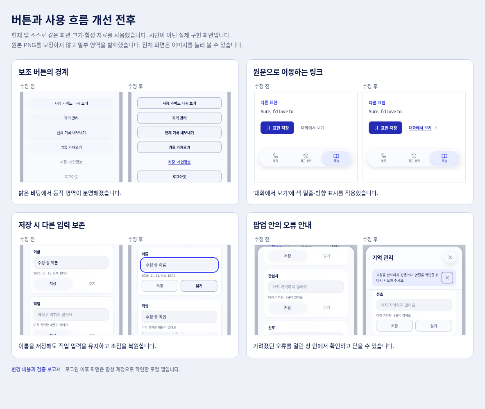

# 앱 사용성 개선 · 2026-11-11

버튼 인지성 검토의 8개 항목을 반영하고, 추가로 발견한 입력 손실·팝업 오류 안내·주간 정보 중복·키보드 탐색 문제를 수정했다. 기존 로고·캐릭터·색상과 날짜별 목록 → 개별 표현 상세 구조, 짧은 타입을 유지한다.

[비교 화면 원본](comparison.html) · [수정 전 버튼 검토](../button-affordance-audit-20261111/README.md) · [전체 캡처 목록](screenshots.md) · [기준 버전](source-verification.json) · [검증 로그](verification.txt)

## 반영한 버튼 개선

| 기존 문제 | 반영 내용 | 근거 |
|---|---|---|
| F1. 보조 동작이 회색 설명문처럼 보임 | 실행 버튼은 면·경계·라벨 굵기를 통일했다. 이동 링크는 브랜드 색·밑줄·방향 표시로 구분한다. 다시 말하기 결과는 같은 위계의 3개 버튼으로 배치했다. | [표현 상세](after/08-detail.png), [다시 말하기](after/43-delayed-recall.png) |
| F2. 밝은 글래스 버튼의 경계가 묻힘 | 밝은 화면의 보조 버튼에 중립색 면과 구분되는 경계를 적용했다. 주요 CTA와 어두운 통화 제어의 기존 색상은 유지한다. | [계정 전](before/01-account.png), [계정 후](after/01-account.png) |
| F3. 최근 통화의 상세 진입이 불분명함 | 이름·날짜 영역에 상세 방향 표시를 추가했다. 다시 걸기와 상세 열기는 별도 동작으로 유지한다. | [최근 통화](after/06-history.png) |
| F4. 원문의 ‘복습 목록’이 상세로 이동함 | 중복 뒤로 동작을 제거했다. 원문 → ‘표현 상세’, 상세 → ‘복습 목록’으로 실제 목적지와 표시를 맞췄다. | [원문 전](before/09-source.png), [원문 후](after/09-source.png), [복귀 결과](after/10-source-return.png) |
| F5. 가져오기 키보드 포커스가 사라짐 | 보이지 않는 파일 입력의 초점을 외부 버튼 경계에 표시한다. | [전](before/03-import-focus.png), [후](after/03-import-focus.png) |
| F6. 작은 저장 영역·중복 상세 버튼 | 한 행을 상세 진입과 44×44px 저장의 두 동작으로 정리했다. 화살표는 상세 영역 안의 장식으로 통합했다. | [목록](after/07-review-list.png), [320px 목록](after/13-review-compact.png) |
| F7. 성공 알림이 다른 화면까지 남음 | 일반 알림은 6초 뒤 또는 화면 이동 시 종료한다. 오류는 직접 닫거나 다음 동작을 할 때까지 남긴다. 50분 자동 종료·미저장 기록 등 중요한 안내는 별도로 유지한다. | [기존 잔류 알림](before/45-weekly-persistent-notice.png), [개선 후 동일 대기](after/45-weekly-persistent-notice.png) |
| F8. 긴 기억 창에서 닫기가 사라짐 | 제목·닫기를 고정하고 내용만 스크롤한다. 저장 요청 중에도 창을 닫을 수 있다. | [하단 전](before/05-memory-bottom.png), [하단 후](after/05-memory-bottom.png) |

## 버튼 외에 추가로 발견하고 수정한 문제

### 1. 하나를 저장하면 다른 항목의 미저장 입력이 사라졌다

기억 관리에서 이름과 직업을 입력한 뒤 이름만 저장하면 직업 입력이 빈칸으로 돌아갔다. 서버 응답으로 전체 폼을 다시 만드는 과정에서 작성 중인 값도 교체했기 때문이다. 저장 후 초점도 body로 빠졌다.

이제 현재 계정·캐릭터의 요청 안에서 **다른 항목의 실제 수정 중인 값만** 보존한다. 수정하지 않은 값은 최신 서버 응답을 사용하고, 변경한 항목은 서버 확인 후 반영한다. 저장·실패 후에는 해당 입력/동작으로 초점을 복원한다. 빈 값이나 바뀌지 않은 값의 저장은 비활성화한다.

근거: [입력 손실](before/04-memory-draft-lost.png) → [입력 보존과 초점](after/04-memory-draft-kept.png). 브라우저 회귀 검사에 다른 항목의 입력 보존과 초점 복원을 추가했다.

### 2. 팝업의 오류가 뒤에 가려지고 ‘업데이트 중’이 계속 남았다

기존 전역 알림은 native dialog 밖에 있어 열린 팝업 뒤에 가려졌다. 검색 기록 업데이트가 실패해도 진행 문구가 ‘업데이트 중…’으로 남았다.

이제 열린 창의 제목 영역 안에 오류를 표시하고 닫을 수 있게 한다. 실패 시 진행 상태를 종료하며, 재시도하면 이전 오류를 정리하고 실제 응답에 맞는 결과를 보여준다. 재시도·원본 기록·확인된 저장 상태를 바꾸지 않는다.

근거: [가려진 오류](before/11-memory-error.png), [현재 오류](after/11-memory-error.png), [재시도 후 복구](after/12-memory-recovered.png), [320×568 오류](after/17-memory-error-compact.png).

### 3. 주간 분석의 제목·기간이 반복되고 목표가 요약보다 먼저 나왔다

제목과 기간·생성 시각이 본문과 목표에 중복됐다. 목표를 고르기 전에 분석 내용을 읽는 흐름도 불명확했다.

상단 제목·캐릭터·정확한 분석 기간·생성 시각을 한 번 표시하고 **요약 → 다음 통화 목표** 순서로 정리했다. 원래 저장된 168시간 범위와 생성 시각은 보존하며 조회 시점을 새 분석 기간으로 바꾸지 않는다.

근거: [기존 목표 화면](before/44-weekly-goals.png), [개선한 요약](after/46-weekly-summary.png). 주간 목표 선택·준비·이후 통화·회상 연결 검증도 유지한다.

### 4. 복습 탭의 키보드 선택과 팝업 이름이 불완전했다

두 탭이 모두 Tab 정지점이었고 비동기 갱신 뒤 초점이 사라질 수 있었다. 계정·기억·개인정보 창에는 제목과 연결된 접근성 이름도 없었다.

선택한 탭 하나만 Tab 정지점으로 두고 좌우·Home·End 이동을 지원한다. 응답 뒤에도 선택 탭의 초점을 복구하고 패널과 연결한다. 팝업에는 실제 제목을 접근성 이름으로 연결했다. 방향 이미지는 장식으로 처리해 버튼 이름에 불필요한 화살표를 읽지 않게 한다.

## 흐름별 검수

| 순서 | 흐름 | 결과와 확인 근거 |
|---|---|---|
| 1 | 로그인·초대 제한·이메일 | 보조 링크와 주요 버튼의 위계를 확인했다. 발송 중복·로그인 유지·미승인 계정 차단 검사를 유지했다. 운영 OAuth 완료를 직접 수행한 것은 아니다. |
| 2 | 홈·캐릭터·첫 사용 안내 | 통화·안내·선택 동작이 구분된다. 캐릭터 모션·스와이프와 안내 취소·권한 흐름은 기존 검사를 통과했다. |
| 3 | 연결·통화·속도·취소 | 기존 원형 제어·종료·속도 선택을 유지한다. [통화 화면](after/19-live-call.png). 최신 50분 종료 변경을 합치고 [최종 1분](after/20-call-limit-warning.png)·[종료 저장](after/21-call-limit-saved.png)을 재검증했다. |
| 4 | 통화 종료·전사·학습 노트 | ‘마치기’·재시도·원문 이동을 명확히 했다. 늦은 전사·부분 기록·저장 ACK·노트 준비·초점/스크롤 유지 검사를 통과했다. |
| 5 | 최근 통화·상세·관리 | 상세 진입 방향과 다시 걸기가 구분된다. 저장된 노트와 늦은 전사의 계정·통화 격리, 실패/재시도를 확인했다. |
| 6 | 날짜별 목록·개별 표현·원문 | 타입 하나·선택한 표현 하나를 유지한다. 저장은 서버 확인 뒤 표시하며 원문/목록의 위치와 초점을 복구한다. [목록](after/07-review-list.png), [상세](after/08-detail.png), [원문](after/09-source.png). |
| 7 | 주간 분석·선택형 연습 | 정보 중복을 줄이고 동작을 구분했다. 목표·예약·도움·자기평가·출처 보존과 명시적 선택 원칙을 유지한다. [주간](after/46-weekly-summary.png), [연습](after/43-delayed-recall.png). |
| 8 | 계정·개인정보·내보내기/가져오기 | 버튼·파일 초점·창 제목이 명확하다. 기존 전체 백업·복원 검사를 유지했다. [계정](after/01-account.png), [작은 화면](after/16-account-compact.png), [데스크톱](after/18-account-desktop.png). |
| 9 | 기억 관리·검색 | 다른 입력 보존·활성/비활성·고정 닫기·오류와 재시도를 확인했다. 캐릭터/계정 전환의 오래된 응답 차단 검사를 유지했다. |

## 검증과 범위

- 최초 기준은 `d41b871`이다. 작업 중 추가된 `1eb405d`의 50분 통화 변경을 먼저 합쳤고, 최신 통화 한도·최종 전사·저장을 별도로 재검증했다. 20분 한도로 되돌리지 않는다. 이후 원격에 추가된 `1474b37`의 통화 안정성·진단 변경도 보존해 통합했다. 최종 CI는 이 통합본 전체를 검사한다.
- 사용성 수정 기준에서 로컬 `npm run check`, `npm test` 282개, `npm run test:browser` 전체, `npm run test:presence`, `npm run eval:memory`, `npm run eval:learning`, `npm run build`를 실행했다. 최신 50분 기준 `node test/browser.mjs`도 통과했다. 최종 배포 CI 결과는 배포 확인 후 아래에 기록한다.
- 390×844를 기본으로 320×740, 320×568, 1024×900을 확인했다. 320px·루트 글자 32px 시뮬레이션에서도 가로 넘침 없이 마지막 동작을 메뉴 위로 스크롤할 수 있었다. [큰 글자](after/15-detail-large-text.png). 이 시뮬레이션을 모든 OS 글자 확대/브라우저 줌 검증으로 간주하지 않는다.
- 수정 전후는 같은 화면 크기와 같은 합성 표현·입력으로 캡처했다. 실행 시각은 각 캡처의 합성 통화 시각에 반영되므로 몇 분 차이가 있다. 서버·인증·음성은 통제된 대역이며 실제 학습자 데이터가 아니다. 오류 비교의 수정 전은 최초 기준 커밋을 임시 디렉터리에서 실행했다.
- 전반 WCAG 인증, 실제 사용자 발견 성공률, 학습 효과·음성 품질·운영 계정의 기억 연속성은 이번 UI 검증으로 측정하지 않았다. 공개 로그인은 배포 뒤 실제 URL에서 별도로 확인한다.
- 새 메뉴·설명문을 늘리기보다 기존 동작의 인지성, 데이터 보존과 상태의 정확성을 정비했다. 기본 목록/상세와 타입을 다시 설계하지 않았다.

## 배포 확인

앞선 50분 배포의 [운영 검사 준비 단계](https://github.com/chungchung234/English/actions/runs/43032815041)가 Ubuntu 미러 DNS 오류로 실패했다. 같은 실패가 예상되는 이번 첫 실행은 취소하고, 배포 후 검사에서 이미 제공되는 Chrome과 고정 합성 WAV를 사용하도록 수정했다. 브라우저·폰트·TTS를 매번 시스템 패키지로 설치하지 않는다. 접근 정책·실제 음성·전사·저장 검사는 유지한다. WAV의 PCM 형식·길이와 실제 브라우저 마이크 입력의 음성 신호를 로컬에서 확인했다.

최종 소스 반영과 CI·공개 URL 검증이 완료되면 이 항목과 source-verification.json을 갱신한다.
