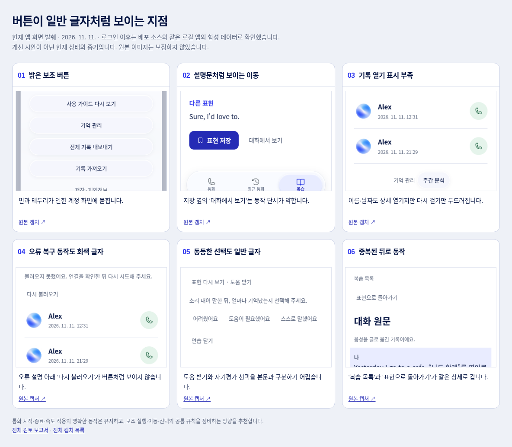

# 앱 전체 버튼 인지성 검토 · 2026-11-11

이 문서는 개선 전 검토 기록이다. [후속 개선과 검증](../app-usability-improvements-20261111/README.md)을 함께 참고한다.

일부 보조 동작이 여전히 일반 글자처럼 보인다. 개별 화면의 문제가 아니라 **회색 텍스트 버튼과 밝은 글래스 버튼을 여러 용도에 공통 사용한 결과**다. 주요 통화 버튼과 속도 선택은 명확하므로 유지하고, 이동·재시도·선택·보조 실행의 시각 규칙을 정비하는 것을 추천한다.

앱 코드와 배포는 변경하지 않았다. 이 문서는 실제 캡처와 조작에 근거한 전문가 검토이며 사용자 참여 실험 결과는 아니다.

[발췌 이미지 원본과 설명](evidence.html) · [전체 캡처 목록](screenshots.md) · [기준 버전 확인 기록](source-verification.json)

## 검토 기준과 증거 범위

- 공개 URL: <https://chungchung234.github.io/English/>
- 공개 빌드: `git:d998452baac429fbff5f4fdd7eac03a046402a96`
- 공개 번들 SHA-256: `af850d82cbd4a2416be2fbf88937c36f049122c4a63bf5eb110accc930a9435f`
- 로컬/원격 main: `d41b871e2811fc6196ba60b06cb5175eb1469e74`. 공개 빌드 이후 차이는 배포 기록 문서뿐이며 앱 소스는 같다.
- 공개 로그인 화면은 운영 URL에서 새로 열었다. 로그인 이후는 같은 소스의 로컬 Chromium에서 합성 계정·대화·서버 응답·마이크·WebRTC로 재현했다. 운영 계정의 개인정보를 조회하거나 메일을 보내거나 실제 통화를 실행하지 않았다.
- 기본 390×844, 추가 320×740·1024×900, 첫 사용 안내 320×568을 확인했다. 320px에서 루트 글자 크기를 32px로 키우는 확대 시뮬레이션도 수행했다.
- 클릭, 뒤로 이동, Tab/Shift+Tab, disclosure 열기, 스크롤, 실패 후 재시도를 직접 실행했다. 화면과 DOM의 버튼 크기·색상·포커스·활성 여부를 대조했다.
- 공유 브라우저 연결이 실패하여 실행 환경의 Chromium을 사용했다. 외부 OAuth 완료, 운영 계정 데이터, iOS/Android 네이티브 선택기, 실기기 터치, 전체 WCAG 적합성을 검증한 것은 아니다.

## 화면 흐름별 상태

| 순서 / 화면 | 전반 상태 | 확인한 사항과 근거 |
|---|---|---|
| 1. 로그인 → 이메일 | 주요 동작 명확 / 보조 링크 개선 | Google·Kakao·코드 받기는 명확하다. ‘이미 받은 코드로 로그인’은 회색 일반 글자에 가깝다. [01](screens/01-public-login.png), [02](screens/02-public-email.png) |
| 2. 홈 → 안내 → 통화 준비 | 주요 동작 명확 | 녹색 통화와 안내의 다음 버튼은 알아보기 쉽다. 안내 닫기 같은 낮은 우선순위 동작은 맥락상 구분되지만 공통 회색 버튼 규칙을 사용한다. [36](screens/36-first-home.png), [11](screens/11-guide.png), [35](screens/35-guide-compact.png) |
| 3. 연결 → 통화 → 속도·대화문 | 대체로 양호 | 통화 종료의 빨강, 원형 제어, 속도 선택·적용, 선택 상태와 키보드 포커스가 명확하다. 연결 취소와 연결·마이크 오류 재시도도 분명하다. [13](screens/13-live-call.png), [14](screens/14-speed.png), [15](screens/15-speed-keyboard.png), [32](screens/32-call-failure.png), [33](screens/33-microphone-denied.png), [34](screens/34-connecting-cancel.png) |
| 4. 통화 종료 → 대화 기록 → 학습 노트 | 주요 동작 명확 / 종료·관리 동작 개선 | ‘학습 노트 보기’는 명확하다. 상단 ‘마치기’와 노트 관리의 일부 동작은 일반 글자처럼 보인다. 빈 노트와 준비 완료 상태를 각각 확인했다. [18](screens/18-post-call-ready.png), [19](screens/19-call-note-empty.png), [23](screens/23-call-note.png) |
| 5. 최근 통화 → 상세·관리·재시도 | 개선 필요 | 기록 행의 상세 진입 표시가 약하고 다시 걸기만 두드러진다. ‘기억 관리’, 통화 관리 동작과 실패 시 ‘다시 불러오기’도 약하다. 재시도 후 복구를 확인했다. [20](screens/20-history.png), [21](screens/21-call-detail.png), [22](screens/22-call-management.png), [31](screens/31-history-retry.png) |
| 6. 복습 목록 → 표현 상세 → 대화 원문 | 개선 필요 | 목록의 경계·화살표와 상세 ‘표현 저장’은 명확하다. ‘대화에서 보기’는 설명문처럼 보이고 원문의 뒤로 문구와 목적지가 다르다. 목록 아이콘의 터치 폭도 좁다. [26](screens/26-review-list.png), [28](screens/28-expression-actions.png), [29](screens/29-expression-source.png), [30](screens/30-source-back-result.png) |
| 7. 주간 분석·의도 보충·예약·다시 말하기 | 개선 필요 | 조건부 기능도 실제 경로로 열었다. 목표 선택, 제안 수락·보류, 날짜 선택, 도움·자기평가 동작이 회색 글자로 나열된다. 저장 알림이 화면 이동 후에도 남는다. [41](screens/41-intent-decision.png), [42](screens/42-recall-schedule.png), [43](screens/43-delayed-recall.png), [45](screens/45-weekly-persistent-notice.png) |
| 8. 계정 → 내보내기·가져오기·개인정보 | 개선 필요 / 포커스 결함 | 밝은 보조 버튼의 경계가 약하다. 가져오기는 실제 Tab 포커스가 보이지 않는다. 개인정보 안내와 닫기는 정상적으로 열린다. [04](screens/04-account.png), [05](screens/05-account-keyboard-button.png), [06](screens/06-account-keyboard-file.png), [10](screens/10-privacy.png), [40](screens/40-account-desktop.png) |
| 9. 기억 관리 → 저장·검색 | 개선 필요 | 합성 이름을 저장해 활성 ‘잊기’와 비활성 ‘잊기’를 비교했다. 저장·검색 보조 버튼은 경계가 약하다. 긴 창에서는 닫기가 위로 사라진다. [46](screens/46-memory-saved.png), [08](screens/08-memory-bottom.png), [09](screens/09-memory-search-expanded.png) |

## 발견 사항과 우선순위

P1은 우선 수정할 공통 문제 또는 명확한 접근성 결함, P2는 탐색·조작을 어렵게 하는 문제, P3는 보완 사항이다. 사용 빈도나 이탈률을 측정한 심각도 점수는 아니다.

### F1 · P1 · 실행 가능한 동작과 설명문이 같은 모습이다

**위치:** 복습 ‘대화에서 보기’, 최근 통화 ‘다시 불러오기’, 통화 관리, 다시 말하기의 도움·결과 선택, 주간 목표 선택 등.

실제 버튼인데도 배경·테두리·밑줄이 없고 본문 보조 문구와 같은 `#59647c`다. ‘표현 저장’ 옆의 ‘대화에서 보기’는 특히 대비된다. 읽기 어려운 글자라는 뜻이 아니라 **누를 수 있다는 단서가 없다**는 문제다. 모바일에는 마우스 커서나 hover가 없다.

근거: [28](screens/28-expression-actions.png), [31](screens/31-history-retry.png), [43](screens/43-delayed-recall.png), [44](screens/44-weekly-goals.png). 공통 원인: [style.css:133](https://github.com/chungchung234/English/blob/d41b871e2811fc6196ba60b06cb5175eb1469e74/web/style.css#L133)의 `.quiet-button,.text-button`.

**권장:** 이동은 화살표·밑줄 등 일관된 링크 단서, 보조 실행은 명확한 중립색 경계, 실패 복구는 중요도에 맞는 버튼으로 구분한다. 자기평가처럼 동등한 선택은 같은 위계의 버튼 그룹으로 표현한다. 모든 동작을 큰 파란 버튼으로 바꾸지는 않는다.

### F2 · P2 · 밝은 배경에서 글래스 보조 버튼의 윤곽이 묻힌다

**위치:** 내 계정, 기억 관리의 저장·검색/갱신, 통화 상세의 보조 동작.

흰 테두리와 거의 흰 배경을 연한 화면 위에 겹쳐 사용한다. 계정의 반복된 pill 모양은 어느 정도 단서를 주지만 윤곽을 알아보기 어렵다. 기능이 정상이고 높이가 44px여도 인지성은 별개다.

근거: [04](screens/04-account.png), [09](screens/09-memory-search-expanded.png), [46](screens/46-memory-saved.png), [40](screens/40-account-desktop.png). 원인: [style.css:132](https://github.com/chungchung234/English/blob/d41b871e2811fc6196ba60b06cb5175eb1469e74/web/style.css#L132).

**권장:** 밝은 화면의 보조 버튼에는 구분되는 중립색 면과 경계를 사용한다. 기존 남색·파랑 계열과 토큰을 유지한다. 어두운 통화 화면에서 잘 작동하는 원형 제어는 그대로 유지한다. 화면만으로 모든 버튼 경계의 WCAG 대비 위반을 단정하지 않는다.

### F3 · P2 · 최근 통화에서 기록을 열 수 있다는 표시가 부족하다

**위치:** 최근 통화 목록.

이름·날짜 영역 전체가 상세 열기 버튼이지만 화살표가 없고 일반 기록처럼 보인다. 오른쪽의 녹색 다시 걸기만 명확한 동작처럼 보인다. 실제로 이름 영역을 누르면 통화 상세가 열린다.

근거: [20](screens/20-history.png). 관련: [style.css:140](https://github.com/chungchung234/English/blob/d41b871e2811fc6196ba60b06cb5175eb1469e74/web/style.css#L140), [app.js:939](https://github.com/chungchung234/English/blob/d41b871e2811fc6196ba60b06cb5175eb1469e74/web/app.js#L939).

**권장:** 상세 진입 영역에 일관된 방향 단서를 추가하고 다시 걸기는 분리한다. 행 전체가 다시 전화하는 동작으로 바뀌지 않게 한다.

### F4 · P2 · 원문의 ‘복습 목록’이 실제로는 표현 상세로 돌아간다

**위치:** 표현 상세 → 대화 원문.

원문에는 ‘복습 목록’과 ‘표현으로 돌아가기’ 두 버튼이 있다. 둘 다 한 단계 전의 표현 상세로 간다. ‘복습 목록’을 한 번 더 눌러야 목록에 도착한다. 이는 모양 외에 **문구와 이동 결과가 다른 실제 동작 문제**다.

근거: 원문 [29](screens/29-expression-source.png) → ‘복습 목록’ 클릭 후 [30](screens/30-source-back-result.png). 관련: [index.html:91](https://github.com/chungchung234/English/blob/d41b871e2811fc6196ba60b06cb5175eb1469e74/web/index.html#L91), [app.js:1127](https://github.com/chungchung234/English/blob/d41b871e2811fc6196ba60b06cb5175eb1469e74/web/app.js#L1127), [review-journal.js:147](https://github.com/chungchung234/English/blob/d41b871e2811fc6196ba60b06cb5175eb1469e74/web/review-journal.js#L147).

**권장:** 원문 → ‘표현 상세’, 상세 → ‘복습 목록’처럼 실제 목적지를 표시하는 뒤로 동작 하나만 둔다. 위치·포커스 복원은 유지한다.

### F5 · P1 · 파일 가져오기에 키보드 포커스가 보이지 않는다

**재현:** 내 계정에서 Tab으로 내보내기에 도달하면 파란 outline이 보인다. 다음 Tab의 활성 요소는 `#restore`지만 가져오기에 아무 표시가 없다.

실제 파일 입력이 `opacity:0`이고 감싸는 `.file-button`에 `:focus-within` 처리가 없다. 키보드 사용자는 현재 선택 위치를 잃는다. 이는 단순한 시각 취향이 아니라 확인된 포커스 표시 결함이며 WCAG 2.4.7과 관련된다.

근거: [05](screens/05-account-keyboard-button.png) → [06](screens/06-account-keyboard-file.png), 해당 JSON의 `active` 비교. 관련: [style.css:285](https://github.com/chungchung234/English/blob/d41b871e2811fc6196ba60b06cb5175eb1469e74/web/style.css#L285). 반대로 속도 선택과 일반 텍스트 버튼에는 포커스 표시가 정상적으로 보인다: [15](screens/15-speed-keyboard.png), [37](screens/37-source-keyboard.png).

**권장:** 파일 입력의 포커스를 wrapper에 표시한다. 기존 속도 선택·날짜 입력의 포커스 규칙과 통일한다.

### F6 · P2 · 복습 목록의 작은 동작이 밀집하고 상세 열기가 중복된다

390px 화면의 표현 한 행에 본문 상세 열기, 저장, 화살표 상세 열기의 세 Tab 정지가 있다. 저장은 36×44px, 화살표는 24×44px, 열 간격은 2px다. 320px에서는 저장 폭이 32px로 더 줄어든다.

근거: [26](screens/26-review-list.png)와 DOM 측정. 관련: [style.css:578](https://github.com/chungchung234/English/blob/d41b871e2811fc6196ba60b06cb5175eb1469e74/web/style.css#L578), [style.css:602](https://github.com/chungchung234/English/blob/d41b871e2811fc6196ba60b06cb5175eb1469e74/web/style.css#L602), [style.css:626](https://github.com/chungchung234/English/blob/d41b871e2811fc6196ba60b06cb5175eb1469e74/web/style.css#L626).

**권장:** 본문과 화살표를 하나의 상세 진입 영역으로 묶고 저장은 별도 44×44px 이상 영역으로 확보한다. 중첩 버튼을 만들지 않고 두 동작을 나란히 둔다. 44px는 이 검토의 터치 권장 기준이다. 현재 24px 폭만으로 WCAG 2.5.8 위반이라고 단정하지 않는다.

### F7 · P2 · 저장 알림이 다음 화면에서도 남아 일부 내용을 가린다

조건부 학습 화면에서 ‘선택을 저장했어요.’가 표시된 뒤 주간 분석으로 이동해도 검은 알림이 남는다. 같은 화면에서 10초를 더 기다린 캡처도 동일하다. 하단의 다음 목표 내용 위를 덮는다. `pointer-events:none`이므로 클릭을 가로채는 문제와는 다르지만, 가려진 내용이나 동작을 찾기 어렵다.

근거: [44](screens/44-weekly-goals.png) → 추가 10초 후 [45](screens/45-weekly-persistent-notice.png). 관련: [app.js:406](https://github.com/chungchung234/English/blob/d41b871e2811fc6196ba60b06cb5175eb1469e74/web/app.js#L406)은 문구를 설정하기만 하고 [style.css:250](https://github.com/chungchung234/English/blob/d41b871e2811fc6196ba60b06cb5175eb1469e74/web/style.css#L250)은 고정 위치로 표시한다.

**권장:** 일시적인 성공 알림은 정해진 시간 또는 화면 이동 때 종료한다. 사용자의 조치가 필요한 오류·재시도는 해당 영역 안에 남긴다. 하단 고정 알림을 추가 안내문으로 늘리지 않는다.

### F8 · P3 · 긴 기억 관리 창에서 닫기가 스크롤 밖으로 사라진다

검색/하단 항목까지 내리면 위쪽의 닫기가 화면 밖으로 나간다. Escape는 동작하지만 터치 사용자는 다시 위로 이동해야 한다. [08](screens/08-memory-bottom.png), [09](screens/09-memory-search-expanded.png).

**권장:** 긴 창의 제목·닫기 영역을 고정하는 방안을 검토한다.

## 최종 디자인 권장안

새 기능·설명문·컴포넌트 라이브러리를 추가하기보다 기존 버튼 체계를 다음 역할로 정리하는 편이 적절하다.

| 역할 | 표시 원칙 | 해당 예 |
|---|---|---|
| 주요 실행 | 기존 진한 파랑 면, 명확한 라벨. 통화 시작의 녹색·종료의 빨강 유지 | 표현 저장, 속도 적용, 학습 노트 보기 |
| 보조 실행 | 밝은 화면에서 구분되는 면·경계, 44px 이상 높이, 읽기 쉬운 라벨 | 내보내기·가져오기, 기억 저장, 재시도 |
| 화면 이동 | 방향 아이콘 또는 밑줄 등 일관된 링크 단서와 실제 목적지 문구 | 대화에서 보기, 복습 목록, 통화 상세 |
| 동등한 선택 | 같은 크기·같은 위계의 버튼 그룹, 누른 결과·대기 상태 표시 | 다시 말하기 결과, 연습 날짜, 주간 목표 |
| 접기·펼치기 | 행 전체를 누를 수 있게 하고 화살표/±와 열린 상태 일치 | 통화 관리, 기억 검색 |
| 아이콘 동작 | 분리된 충분한 터치 영역, 접근 가능한 이름, 선택·포커스 구분 | 저장, 닫기, 새로고침 |

수정 순서는 **공통 텍스트/보조 버튼과 파일 포커스 → 뒤로 목적지·알림 잔류 → 목록 터치 영역·세부 일관성**을 추천한다. 표현 타입 표시는 읽는 정보이므로 버튼처럼 꾸미지 않는다. 사용자가 이미 선택한 목록/상세 구조와 짧은 타입 이름도 유지한다.

완료 판정은 ‘CSS가 적용됐다’가 아니라 동일한 화면에서 기본·hover·키보드 포커스·눌림·선택·비활성·실패 상태를 비교해 해야 한다. 특히 스마트폰에서 hover 없이 동작을 구분할 수 있어야 한다.

## 확인된 강점과 검증 한계

- 통화와 속도 제어, 주요 CTA, 복습 목록의 행 경계·화살표는 유지할 가치가 있다. 개인정보 안내/기억 검색의 disclosure도 기존 단서가 있다.
- 320px와 글자 확대 시뮬레이션의 표현 상세는 가로 넘침이 없었고 끝까지 스크롤하면 저장·원문 동작이 하단 내비게이션 위에 노출됐다. 이를 영구적인 하단 가림 문제로 보고하지 않는다. [38](screens/38-detail-compact.png), [39](screens/39-detail-large-text.png)
- 힌트 비활성 상태는 합성 통화 준비 상태를 반영한다. 운영에서 항상 비활성이라는 결론은 내리지 않는다.
- 현재 통화 UI의 모든 상태, 운영 오류 발생률, 분석 문장의 학습 품질이나 실제 사용자의 발견 성공률까지 검증한 것은 아니다.
- 새로 실행한 `node test/first-use.browser.mjs`는 통과했다. 추가 캡처를 삽입한 임시 복사본의 enhancement acceptance 6개 시나리오도 통과했다. 이는 합성 전송/데이터를 사용한 기능 검사이며, 위 디자인 문제를 해결했거나 사용자 검증을 통과했다는 뜻이 아니다. [실행 로그](verification.txt)
