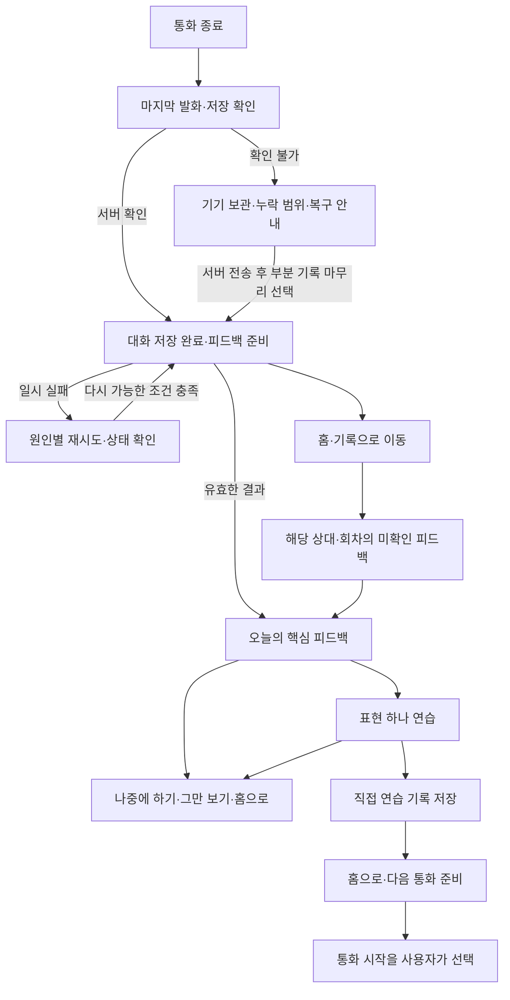

# 시시콜콜 — 통화 이후 플로우 1차 출시 전 기획 기준선

작성·개정일: 2026-11-10 · 정책 기준선: r2 · 진행 상태: 최종 배포 디자인 통합·출시 인수

이 문서는 통화 이후 기능·행동·상태 기준이다. 사용자가 현재 배포된 디자인을 최종형태로 확정함에 따라 해당 화면·스타일·이미지·모션을 유지하고 기능을 통합했다. 실제 사용자 조사와 운영상 외부 제약은 구현 완료와 구분한다. 검증 결과는 [검증 보고서](post-call-validation.md), 운영 점검은 [운영 보고서](production-readiness-20261110.md)에 기록한다.

## 1. 목표, 대상과 완료의 의미

**목표:** 통화를 마친 사용자가 원하면 표현 하나를 정확히 골라 연습하고, 다음 접속과 통화에서 이어갈 수 있게 한다. 바로 끝내고 싶은 사용자에게 복습을 의무로 만들지 않는다.

초기 검증 대상은 한국어 안내를 사용하는 성인 영어 학습자 중 짧은 일상 대화와 통화 후 선택형 교정을 원하는 사람이다. 특정 영어 등급·숙달도를 추정하지 않는다. 첫 이용자, 반복 이용자, 복습을 건너뛰는 이용자, 오랜만에 돌아온 이용자를 모두 검증한다. 이 대상 설정은 제품 가설이며 사용자 조사 결과가 아니다.

기획 준비와 실제 구현 인수는 별도 게이트다. 로컬 앱 인수는 구현·DB·브라우저 실행 증거로 확인한다. 디자인 기준선은 사용자가 확정했으며 실제 사용자 관찰·운영 계정·관리형 백업 복구까지 통과했다고 확대 해석하지 않는다.

## 2. 현재 사실과 범위

다음은 저장소 문서·코드의 정적 확인 사실이며 현재 운영 환경을 실연결해 확인한 결과는 아니다.

| 사실 | 기획에 주는 제약 | 근거 |
| --- | --- | --- |
| 최종 수신 전사문은 기기 대기열을 거쳐 서버에 저장하며 서버 확인 후 대기열을 제거 | 기기 보관과 클라우드 저장을 구분 | [README](../README.md), [outbox](../src/outbox.js) |
| 전사되지 않았거나 OS가 이벤트 수신 전에 종료한 음성은 복구 보장 불가, 원본 녹음 미보관 | 누락 음성 복원·원본 다시 듣기를 약속하지 않음 | [README](../README.md) |
| 회차 피드백은 종료된 회차의 사용자 발화 기반, 원문 변경 시 분석 캐시 변경 | 출처·버전·분석 범위와 갱신 상태 필요 | [분석 처리](../supabase/functions/coach/index.ts) |
| 주간 분석은 상대별 종료 통화의 직전 168시간, 사용자 요청 시 생성 | 달력 주간과 구분하고 실제 시작·종료 일시 표시 | [분석 처리](../supabase/functions/coach/index.ts) |
| 계정과 Mia·Alex·Juno별로 기억·피드백 맥락 분리 | 다른 상대의 표현·근거를 합쳐 보여주지 않음 | [README](../README.md) |
| 사용자별 UTC 일일 예약 한도: 음성 30, 회차 교정 20, 주간 분석 3 | KST 매일 09:00 갱신. 새로운 예약을 얻는 실패 후 재시도도 한도를 쓸 수 있음 | [예약 정책](../supabase/migrations/202611090001_init.sql) |
| 음성·전사·교정·주간 분석은 기존 모델 티어링 사용 | 새 기능을 이유로 일괄 상위 모델 전환하지 않음. 비용 절감 실측 주장 금지 | [README](../README.md) |

새 복습 상태·선정·계측 정책과 인수 기준은 아래 D01~D12로 정의한다.

## 3. 결정 목록과 출시 경계

| 결정 | 1차 필수 정책 | 2차 이후 범위 |
| --- | --- | --- |
| D01 | 정상·건너뛰기·닫기·재진입의 일관된 경로 | 진입 개인화 실험 |
| D02 | 오류와 대안 표현 구분, 우선순위 선정, 잘못된 피드백 제외 | 자동 교정 품질 모델 고도화 |
| D03 | 추천량 상한, 중복 병합, 미루기·보관·그만 보기 | 적응형 1·3·7일 복습 간격 |
| D04 | 보고/가리고 말하기, 직접 연습 표시와 저장 확인 | 녹음·발음 자동 평가 |
| D05 | 준비·미확인·확인 상태와 비동기 발견 경로 | 푸시·이메일 알림 |
| D06 | 저장·전사·생성·한도·입력 크기·인증 오류별 복구 | 백그라운드 작업 기반시설 고도화 |
| D07 | 계정·상대 소유권, 원문·피드백 버전, 이력 유지, 백업 호환 | 학습 이력의 상대 간 통합 |
| D08 | 선택형 다음 상황과 목표 표현 하나 연결, 실제 시작은 별도 행동 | 자동 표현 재사용 탐지·숙달 추정 |
| D09 | 최초 출시부터 이벤트 계약·지표·오프라인 처리 | 분석 대시보드·정교한 학습 효과 실험 |
| D10 | 기기·서버 저장, 한도와 시간대, 데이터·문구의 구분 | 추가 발송 채널·새 요금제 |
| D11 | 상태·행동의 접근성 인수 조건 | 시각 스타일·레이아웃은 별도 디자인에서 결정 |
| D12 | 기획 검증과 실제 제품 출시 게이트의 분리 | 실제 결과에 따른 정책 조정 |

계정·상대 분리, 중복 방지, 저장 실패 복구, 원문 변경 대응, 새 복습 데이터의 백업·복원, 최소 계측은 2차로 미룰 수 없다. 기존의 요청형 최근 7일 분석은 유지하고 실제 범위와 생성 시점을 명확히 한다.

## 4. D01 — 기본 흐름과 탭별 역할

| 진입 | 우선 보여줄 정보 | 기본 후속 행동 |
| --- | --- | --- |
| 통화 직후 | 방금 회차의 저장·피드백 상태 | 준비 후 핵심 피드백. 언제든 홈으로 종료 가능 |
| 홈 재방문 | 상대가 명시된 미확인 피드백 또는 오늘 추천 표현의 짧은 안내 | 통화 시작을 방해하지 않고 선택적으로 이어보기 |
| 복습 탭 | 최신 미확인 피드백 안내 → 오늘 추천 표현 → 지난 피드백·보관함 → 요청형 7일 분석 | 사용자가 이미 보고 있던 회차·표현은 비동기 완료로 바꾸지 않음 |
| 기록 탭의 회차 선택 | 그 회차의 원문·피드백·복구 상태 | 해당 회차 확인 또는 복구 |
| 상대 변경 | 변경한 상대의 상태와 데이터만 | 이전 상대의 열린 복습·조회 결과는 닫고 새 범위를 안내 |

통화 후 기본 행동은 표현 하나 연습이며 나중에 하기와 홈으로도 항상 선택할 수 있다. 연습 완료 후 기본 행동은 홈으로, 보조 행동은 다음 통화 준비다. 추가 통화나 마이크 권한을 자동 요청하지 않는다.

## 5. D02 — 피드백 품질·선정·이의 처리

### 내용과 선정 순서

핵심 피드백은 요약 한 줄, 근거 있는 잘한 점 최대 한 개, 핵심 교정 최대 두 개로 구성한다. 분석 근거가 부족하면 잘한 점과 교정은 생략하고 이유를 안내한다.

| 분류 | 사용자에게 전달할 의미 | 선정 원칙 |
| --- | --- | --- |
| 의미·문법 오류 | 의도 전달을 방해하거나 문법 수정이 필요한 표현 | 의미 전달 영향 → 동일 원인의 반복 → 다음 상황 활용도 → 현재 발화에 비춘 난이도 순 |
| 선택 가능한 대안 | 원래 말도 가능하나 더 간결·정중하게 표현할 수 있음 | 오류와 명칭·설명을 구분. 취향 차이를 오답처럼 설명하지 않음 |
| 근거 부족·전사 의심 | 입력만으로 판단하기 어려움 | 확신하는 교정을 만들거나 복습 항목으로 자동 등록하지 않음 |

각 항목은 실제 사용자 발화 근거를 연결한다. 복습 후보는 최대 세 개이며 가장 적절한 한 개만 기본 추천에 등록한다. 나머지는 사용자가 선택하면 등록한다. 적절한 후보가 없으면 다음 대화로 마무리하고 등록량을 채우지 않는다.

### 사용자 이의와 제외

- ‘내가 한 말이 아니에요’: 원문을 임의 수정하지 않고 해당 발화의 교정·추천·자동 학습효과 판정을 보류로 전환한다. 과거 노출·수행 행동은 사실대로 남기되 품질 보류 사례로 분리해 보고한다.
- ‘의도와 달라요’: 해당 교정과 파생 복습을 보류한다. 같은 입력을 반복 분석해 해결됐다고 간주하지 않는다.
- ‘이미 아는 표현이에요’ 또는 ‘그만 보기’: 사용자의 추천 제외 선택으로 기록한다. 자동 숙달 판정이나 영어 수준 상승으로 기록하지 않는다.
- 보류·제외 의사는 즉시 현재 기기에 반영하고 서버 확인 전에는 ‘제외 반영 대기’로 표시한다. 동일 요청 재전송으로 중복 처리하지 않는다.
- 제외한 항목을 다음 통화 문맥에서 다시 추천하지 않는다. 근거 자체를 계속 쓰기 어려우면 그 항목을 생략하고 일반 대화를 진행한다.
- 제외와 원문 삭제는 다르다. 서버에서 기록을 읽는 다른 기기는 서버 반영 후 동일 상태가 적용되며, 이미 시작한 통화의 전송된 문맥을 회수했다고 주장하지 않는다.
- 사용자 선택으로 제외를 해제할 수 있으나 품질 보류 항목은 검증된 새 피드백이 생기기 전 자동 재노출하지 않는다.

## 6. D03·D04 — 복습량·수행 상태와 이어보기

### 추천량과 쌓인 표현 관리

현재 선택한 상대 기준으로 오늘 기본 추천은 한 개다. 사용자가 더 연습하기를 선택하면 하루 최대 세 개의 서로 다른 항목을 추천한다. 전체 보관함 탐색·직접 연습은 제한하지 않는다. 날짜는 Asia/Seoul 기준이다.

추천 순서는 사용자가 명시적으로 선택한 표현 → 최근 미연습 핵심 표현 → 다시 보고 싶다고 고른 표현 → 노출 가능일이 지난 미룬 표현이다. 보류·제외 항목은 추천에서 제외한다. 같은 상대의 동일한 표현은 하나로 묶고 출처 회차는 여러 개 연결할 수 있다. 한 출처가 무효가 돼도 다른 유효 출처가 있으면 그 출처로 유지하고, 모든 출처가 보류·무효면 자동 추천을 중단한다. 사용자의 표현 전체 그만 보기는 모든 출처에 적용한다. 문법·의미가 달라진 표현을 의미 유사성만으로 자동 병합하지 않는다.

| 행동·상태 | 의미 | 다음 노출 |
| --- | --- | --- |
| 미연습 | 아직 수행 표시하지 않음 | 추천량 상한과 순위 안에서 제안 |
| 복습 닫기 | 지금 창을 떠남, 수행·미루기 의사 미확정 | 항목 상태 유지. 같은 화면에서 즉시 다시 열지 않음 |
| 나중에 하기 | 당분간 추천을 미룸 | 첫 선택은 다음 KST 날짜부터. 연속 두 번째 선택은 7일 뒤부터, 다시 미루면 보관 선택도 제안 |
| 직접 연습함 | 사용자가 연습했다고 표시했고 서버가 저장 확인 | 미완료 추천에서 제외. 보관함에서 수동 반복 가능 |
| 다시 보고 싶어요 | 사용자가 재노출을 원함 | 다음 KST 날짜부터 추천 후보. 수행 이력은 보존 |
| 이미 앎·그만 보기 | 추천에서 제외하는 사용자 선택 | 사용자가 되돌리기 전 자동 추천 금지 |
| 14일간 미접속한 과거 미연습 | 오래 쌓인 항목 | 삭제하지 않고 보관함에 유지. 복귀 첫날 추천은 최근 한 개로 시작 |

1·3·7일 간격의 자동 반복 복습은 1차에서 제외한다. 횟수만으로 숙달·졸업을 결정하지 않는다. 별도의 알림 발송도 1차에 포함하지 않는다.

### 짧은 복습과 저장

내 표현 → 추천 표현 → 짧은 설명을 확인하고 소리 내어 말한 뒤, 표현을 가려 회상할 수 있다. 가리기는 선택이며 원하면 다시 보여준다. 마이크·녹음·자동 채점 없이 ‘직접 연습했어요’를 선택한다. 기본 한 표현으로 마무리할 수 있다.

저장 상태는 미전송·기기 보관 확인·서버 저장 확인·저장 실패를 구분한다. 기기 저장에 성공했다면 닫기·재접속 후 동일 행동을 전송한다. 기기 보관도 실패하면 ‘저장하지 못했어요’로 표시하고 성공이나 복원을 약속하지 않는다. 연속 클릭·재전송·다른 기기의 같은 요청은 동일 행동 ID로 중복 반영하지 않는다.

서버 확인 후에만 연습 저장 완료로 표시한다. 같은 표현의 같은 KST 날짜 수행 횟수는 한 번만 증가시킨다. 다른 날짜의 수행은 별도 이력이며 일괄 회차 단위로 제거하지 않는다. 이미 수행한 날에 미루기를 선택해도 수행 이력을 지우지 않는다. 동기화 권위는 서버의 항목 상태 버전이다. 상태 변경은 행동 ID와 사용자가 확인한 기준 버전을 함께 전송한다. 서버는 동일 행동 ID의 재전송에는 원래 결과를 반환하고, 새 행동의 기준 버전이 현재 버전과 다르면 자동 반영하지 않고 충돌과 최신 상태를 반환한다.

충돌한 수행·제외·제외 해제 의사는 기기에 보류하고 사용자에게 최신 상태와 다시 선택하는 경로를 제공한다. 서버 반영 전에는 완료 이벤트를 발행하지 않는다. 제외 해제도 최신 버전에서의 명시적 선택이 필요하다. 늦게 받은 이전 성공 응답이 더 최신 버전을 덮어쓰지 않게 한다. 기기 시각만으로 요청의 우선순위를 정하지 않는다. 보류 중인 제외 의사는 현재 기기에서 계속 추천을 막되 다른 기기에 이미 반영됐다고 표시하지 않는다.

## 7. D05·D06 — 작업 상태·대기·복구

### 서로 독립인 상태 축

| 축 | 상태 | 불변 조건 |
| --- | --- | --- |
| 통화 기록 | 전사 확인 중·기기 보관 확인·서버 전송 대기·서버 저장 확인·부분 기록 | 음성 연결 종료를 기록 저장 성공으로 해석하지 않음 |
| 피드백 | 미요청·준비 중·완료 미확인·노출 확인·실패·원문 변경으로 갱신 필요 | 준비 상태와 열람 상태를 별도로 보존 |
| 표현 | 미연습·미룸·직접 연습함·추천 제외·품질 보류 | 이력과 현재 추천 여부를 분리 |
| 행동 전송 | 미전송·기기 보관 확인·서버 반영·실패 | 서버 확인 없는 성공 표시 금지 |

‘노출 확인’은 읽거나 이해했다는 뜻이 아니다. 피드백 준비 완료는 해당 상대·회차에 미확인 표시를 남긴다. A 회차 준비 중 B 통화를 진행해도 결과·알림은 A에 연결하며, 현재 통화·보고 있는 피드백·선택한 상대를 바꾸지 않는다. 홈·복습·기록에서 같은 회차로 찾을 수 있게 한다.

### 대기와 재진입 정책

- 저장 확인 대기가 10초를 넘으면 진행 표시만 반복하지 않고 확인된 기기 보관·서버 전송 상태와 떠날 때의 영향을 안내한다. 10초는 안내 전환 기준이며 저장 완료 SLA나 대기 중단 기준이 아니다.
- 서버 미확인 상태에서도 사용자는 홈으로 이동할 수 있다. 앱을 닫거나 로그아웃하면 전사 중 음성은 복구가 보장되지 않고, 기기 대기열은 같은 기기·같은 계정에서만 복구할 수 있음을 안내한다.
- 전사·저장에 문제가 있으면 종료를 성공 처리하지 않는다. 확인된 발화를 먼저 서버에 전송한 후 사용자가 누락 안내를 확인하고 ‘수신된 기록으로 마무리’를 선택할 수 있다. 사용자 발화가 하나도 없으면 피드백 생성 대신 기록 확인·다음 통화를 제공한다.
- 피드백 요청이 시간 초과돼도 서버 작업 실패로 단정하지 않는다. 작업 상태를 조회하고 결과가 있으면 복원한다. 실행 중이면 새 분석을 중복 요청하지 않는다.
- 앱을 닫아도 서버 분석이 반드시 완료된다고 약속하지 않는다. 재진입 시 서버 상태·결과·작업 유효시간을 확인하고 중단·만료된 경우에만 재요청을 허용한다. 클라이언트의 ‘준비 중’ 표시만으로 무기한 잠그지 않는다.
- 전사 대기와 기기 저장 한계를 안내한 뒤 화면을 떠날 수 있어야 하며, 새로운 통화는 이전 마이크 연결을 종료·정리한 후 시작한다. 미전송 대기열은 삭제하지 않는다.
- 데이터 전송 재시도와 분석 재요청을 구분한다. 서버 저장 재전송은 복구 정책에 따르고, 새 분석 호출은 사용자 재시도 선택으로만 수행한다. 계정 만료 시 다른 계정으로 자동 재전송하지 않는다.

### 오류별 행동

| 원인 | 안내·다음 행동 | 새 분석 요청 |
| --- | --- | --- |
| 오프라인·저장 실패 | 확인된 보관 위치, 재연결·재전송, 동일 계정 안내 | 서버 저장 확인 전 금지 |
| 전사 일부 누락 | 포함·제외 범위를 확인하고 부분 기록으로 마무리 | 사용자가 부분 기록 마무리를 선택한 후 가능 |
| 일시 분석 오류·검증 실패 | 대화는 저장됨, 수동 재시도와 홈으로 | 서버에 실행 중 작업이 없을 때 가능 |
| 처리 중 | 상태 확인, 다른 화면 이동 | 유효한 기존 작업이 있으면 금지 |
| 일일 한도 초과 | 기존 기록·복습 탐색, 정확한 다음 가능 일시 | 갱신 전 비활성. 반복 클릭 권장 금지 |
| 입력 크기 초과 | 원문은 유지, 이번 자동 분석 불가와 다음 통화를 짧게 할 안내 | 같은 입력으로 재시도 금지. 사용자 몰래 일부만 분석하지 않음 |
| 인증 만료 | 동일 계정 재로그인 후 상태 복구 | 인증·소유권 확인 후 가능 |
| 서비스 중단·설정 문제 | 사용 불가 상태와 기존 기록 접근 가능한 경로 | 복구 확인 전 반복 요청 권장 금지 |

화면에는 원시 오류·모델 요청 정보 대신 사용자 행동에 필요한 이유를 제공한다. 알려진 복구 시각이 없으면 특정 시각의 정상화를 약속하지 않는다.

## 8. D07·D10 — 이력·데이터·시간대

- 사용자·상대·원본 회차·발화 버전·피드백 버전·표현·수행 행동을 구분한다. 클라이언트 선택만으로 소유권을 신뢰하지 않는다.
- 피드백 재생성 시 같은 표현은 이력을 유지한다. 대소문자·공백·문장부호 외의 단어·문법·의미 변경은 새 항목으로 안내하고 자동 숙달·수행 이력을 이전하지 않는다.
- 삭제·무효·품질 보류된 교정은 현재 추천에서 제거하되 이전에 수행했다는 이력은 과거 출처·상태와 함께 보존한다. 원문 변경 시 이전 피드백을 최신 결과로 표시하지 않는다.
- 새 복습 데이터도 내보내기·복원에 포함한다. 기존 백업 형식을 지원하고, 복원 실패 배치·성공 범위와 재시도를 안내한다. 백업의 분석은 원문으로 다시 생성한 후 일치하는 표현에 자기 보고 이력만 연결한다.
- 복원 파일의 표현이 새 피드백에 없으면 사용자 가져온 연습 이력으로 보관하며 현재 추천·검증된 교정으로 쓰지 않는다. 이미 더 최근인 서버 상태를 오래된 백업으로 덮어쓰지 않는다.
- 이 문서의 ‘보관·제외’는 삭제 요청이 아니다. 신규 원문 삭제 기능은 별도 범위다. 계정·원문이 삭제되는 경로가 도입되면 파생 표현·기억·근거·행동 데이터도 소유권과 원문 연결에 맞춰 제거하는 조건을 적용한다.
- 원본 녹음 보관·발음 점수·자동 숙달 판정·상대 간 학습 데이터 공유는 1차에 포함하지 않는다.
- 복습 날짜는 KST 달력일 기준, API 한도는 UTC 달력일 기준이다. 한도 갱신은 KST 매일 09:00이며 ‘내일’만으로 안내하지 않는다. 11월 10일 08:59 KST에는 당일 09:00, 10:00에는 11월 11일 09:00으로 표시한다.
- 새 예약을 받는 분석 재시도는 한도를 쓸 수 있다. 완료 결과 재사용·유효한 처리 중 상태 조회·복습 저장은 새 모델 예약과 구분한다. 모델 호출 횟수 제한을 금액 상한으로 설명하지 않는다.
- 동작 계측에는 원문·음성·표현 내용·이메일을 중복 저장하지 않는다. 계정 범위의 식별자와 상태·시각만 사용한다. 개인정보 안내에는 복습 수행과 사용 상태가 계정에 저장됨을 설명한다.

## 9. D08 — 다음 통화 연결과 2차 학습 가설

1차에서는 선택한 표현 한 개에 맞는 다음 상황을 제안한다. 기존 상황 추천이 목표 표현을 쓰기 어려운 경우에는 일반 상황으로 안내하고 연결을 보장하지 않는다. 사용자는 상황을 바꾸거나 바로 홈으로 갈 수 있다.

‘다음 통화 준비’는 상대·선택한 목표 표현·상황을 저장할 뿐 통화를 시작하지 않는다. 새 통화 전에는 서버 상태뿐 아니라 현재 기기의 반영 대기 제외·품질 보류 의사를 학습 문맥 구성에 반영한다. 이 필터링을 확인할 수 없으면 이전 학습 문맥과 목표 표현을 생략하고 일반 대화로 시작한다고 안내한다. 분석·기억 검색의 다른 경로로 같은 제외 표현을 연습 목표로 다시 넣지 않는다. 같은 상대의 다음 통화에서 아직 유효한 표현을 한 번 자연스럽게 쓸 기회를 제공한다. 제외·보류된 표현은 전송하지 않는다. 다른 주제를 고르거나 이미 충분히 대화하고 있으면 목표 표현을 강요하지 않는다.

직후 예문 따라 말하기와 새로운 상황에서의 사용은 다르다. 1차는 자동 재사용 성공·실패를 표시하지 않는다. 2차의 동일 표현 탐지에서는 사용자 발화·같은 상대·수행 이후·사용 기회를 구분하고, 예문 반복·도움받은 사용·자발적 사용을 분리할 수 있는 증거를 확보해야 한다. 증거가 없으면 구분 불가로 남긴다. 유사한 변형을 못 썼다고 판단하거나 숙달 점수를 만들지 않는다.

## 10. D09 — 최초 출시 계측 계약

### 이벤트 조건

공통 필드는 이벤트 ID, 익명화된 계정 범위 키, 상대 ID, 귀속 유형과 원본 회차 ID(비귀속이면 비움), 필요한 경우 피드백 버전·표현 ID·연습 시도 ID·행동 ID, 발생 시각·서버 수신 시각, 성공/대기/실패 상태다. 새 통화의 실제 회차 ID는 원본 귀속 회차와 구분한다. 콘텐츠 원문은 넣지 않는다.

| 이벤트 | 발생 조건 | 중복 제거·단위 |
| --- | --- | --- |
| feedback_ready | 최신 원문 기반 피드백이 서버에 저장됨 | 회차+원문/피드백 버전 |
| feedback_exposed | 앱이 전경이고 핵심 피드백 영역의 절반 이상이 1초 이상 표시됨 | 회차+피드백 버전. 읽음·이해로 해석 금지 |
| practice_started | 사용자가 연습하기·이어서 연습을 명시 선택 | 표현+연습 시도 ID. 단순 화면 렌더링 제외 |
| practice_saved | 직접 연습 행동의 서버 저장 확인, 시작 시도 ID와 표현 ID 필수 연결 | 행동 ID. 하나의 저장은 연결된 한 시도만 완료. 표현+KST 날짜의 일일 수행은 별도 집계 |
| practice_deferred | 명시적 나중에 하기 서버 반영 | 행동 ID. 창 닫기와 구분 |
| practice_excluded | 알고 있음·그만 보기·품질 보류 의사 서버 반영 | 행동 ID+사유 코드. 원문·자유 입력 수집 금지 |
| next_call_prepared | 다음 상황·유효한 목표 표현 선택 저장 확인 | 준비 ID+원본 회차+목표 표현 |
| call_connected | 실제 새 음성 연결 성공 | 새 회차. 단순 시작 버튼 클릭 제외 |
| flow_failure | 기록·분석·복습 저장 단계 실패 | 요청/행동 ID+단계+고정 원인 코드 |

회차 피드백에서 연습을 시작하면 그 회차·피드백 버전을 시작 시점에 고정한다. 하나로 병합된 표현도 한 시도는 하나의 회차에만 귀속한다. 홈·보관함에서 직접 시작한 연습은 비귀속으로 기록하고 회차별 시작률에서 제외하며 별도 연습량으로 보고한다. 미확인 피드백 안내를 통해 특정 회차를 연 경우에만 그 회차에 귀속한다.

practice_started와 practice_saved는 같은 연습 시도 ID를 사용한다. 두 기기에서 시작한 두 시도 중 한 시도만 저장하면 시도별 완료율은 1/2이며 일일 수행 횟수는 1회다. 시작 이벤트가 늦으면 연관된 완료를 대기하고, 동결 시점까지 대응 시작이 없으면 미연결 진단량으로 분리해 완료율 분자에 넣지 않는다.

같은 행동 ID의 요청 재전송은 동일 이벤트다. 다른 날의 연습이나 새 시도는 같은 원본 회차라는 이유만으로 제거하지 않는다. 원문이 달라진 피드백의 노출은 새 버전으로 구분한다.

오프라인에서 기기 저장한 사건은 발생 시각과 수신 시각을 모두 보존하고 동기화 여부를 구분한다. 저장 확인이 필요한 이벤트는 서버 반영 전 성공 분자에 넣지 않는다. 발생 시각이 비정상인 데이터는 진단 집계로 분리한다. 통계는 지표별 관찰창 종료 72시간 후 잠정 확정하며, 이후 도착분은 별도 지연 반영량으로 보고한다. 불완전한 전송을 실제 사용자 이탈로 단정하지 않는다.

### 지표 정의

회차 전환의 기준 집단은 측정 기간에 서버 종료된 사용자 발화가 있는 회차다. 종료 후 24시간 내 최초로 준비된 유효 피드백 버전을 그 회차의 기준 버전으로 고정한다. 이후 재생성 버전과 24시간을 넘겨 준비된 결과의 전환은 후속 갱신·지연 제공 집단으로 따로 보고하며 기준 버전과 합산하지 않는다. 기준 버전이 나중에 무효·품질 보류가 돼도 과거 실제 행동을 지우지 않고 해당 비율과 함께 보고한다. 유효 후보가 있었는지는 기준 버전 노출 시점에 고정하고, 후속 제외·보류 사례를 구분한 결과도 함께 제시한다. 후속 단계의 모집단은 이전 단계의 관찰창을 모두 충족한 기준 회차·시도로 한정한다. 준비 후 7일을 넘긴 최초 노출과 그 뒤의 연습, 최초 노출 후 7일을 넘긴 시작과 그 뒤의 저장은 지연 집단으로 별도 보고하고 기준 전환율의 분자·분모에는 넣지 않는다.

| 지표 | 분자 / 분모 | 기간·제외 |
| --- | --- | --- |
| 피드백 제공률 | 최신 피드백 확보 회차 / 서버 저장 완료·사용자 발화가 있는 회차 | 종료 후 24시간. 한도·입력 초과·실패도 분모에 포함하고 원인 분리 |
| 피드백 노출률 | 기준 버전이 노출된 회차 / 기준 버전이 준비된 회차 | 각 기준 버전 준비 후 7일. 전체 저장 회차 대비 노출률도 보조 보고 |
| 복습 시작률 | 기준 버전에 귀속된 연습 시작이 있는 회차 / 기준 버전 최초 노출 당시 유효 후보가 있는 회차 | 기준 버전 최초 노출 후 7일. 후보 없는 회차·보관함 비귀속 연습 제외 |
| 복습 저장 완료율 | 같은 시도 ID에 연결된 서버 수행 저장이 있는 시도 / 기준 버전 귀속으로 관찰된 연습 시작 시도 | 기준 버전 최초 노출 후 7일 내 시작한 시도의 각 시작 후 24시간. 재전송 중복 제거, 비귀속·늦은 연습은 별도 집계 |
| 7일 다음 통화율 | 기준 통화 뒤 다른 회차가 실제 연결된 사용자 / 관찰 가능한 기준 통화 사용자 | 사용자별 측정 기간 첫 서버 종료 통화가 기준. 이후 7일 관찰이 끝난 집단만 집계 |

복습 시작률은 회차 단위, 저장 완료율은 시도 단위이므로 하나의 동일 분모 퍼널처럼 곱하지 않는다. 재사용률은 2차 검증 지표이며 1차의 성과 약속으로 쓰지 않는다.

함께 볼 지표는 통화 연결 성공률, 저장 확인 실패율, 준비·저장 소요 시간의 중앙값·상위 지연, 연습 제외·보류율, 요청 한도 도달률이다. 복습 지표가 좋아져도 다음 통화나 저장 신뢰성이 나빠지면 확대하지 않는다.

## 11. D11 — 디자인 전달과 접근성 인수 조건

디자인은 시각 스타일·페이지/시트 선택·배치를 결정한다. 다음 행동 의미와 접근성 조건은 공통 요구사항이다.

- 주요 행동·홈으로·미루기는 키보드와 스크린리더로 접근할 수 있고 포커스가 현재 단계와 맞아야 한다.
- 준비·저장·실패는 색상이나 아이콘만으로 구분하지 않는다. 진행 변화는 적절히 알리고 매 상태 조회마다 반복 발화하지 않는다.
- 비동기 결과가 사용자의 포커스·선택 회차를 빼앗지 않는다. 닫기 후 원래 진입 행동으로 포커스를 돌려준다.
- 긴 표현·큰 글자·작은 화면에서도 핵심 행동과 종료 경로에 접근 가능해야 한다. 고정 내비게이션이 이를 막지 않아야 한다.
- 가린 표현은 보조기술에도 동일하게 숨기고 다시 보기 행동은 항상 접근 가능하게 한다.
- 느린 네트워크·동작 줄이기 설정에서도 단계와 상태를 이해할 수 있어야 한다.

## 12. D12 — 출시 전 검증·이관 기준

### 게이트와 책임

| 게이트 | 책임 역할 | 완료 증거 | 이번 상태 |
| --- | --- | --- | --- |
| G1 기획 기준선 | 기획 담당(이번 문서 작업) | D01~D12 결정, 시나리오 검토, 독립 리뷰, 모순 수정 | 별도 검증 보고서에 결과 기록 |
| G2 디자인 대응 | 사용자 확정 기준선·구현 담당 | 최종 배포 화면·스타일·이미지·모션 유지, 기존 영역에 기능 통합 | 배포 디자인을 최종형태로 확정, 회귀 인수 결과는 검증 보고서 |
| G3 구현 인수 | 구현 담당 | 아래 T01~T32에 대응하는 앱·DB·브라우저·산식 실행 증거와 수동 확인 범위 | 로컬 인수 결과는 검증 보고서에 기록 |
| G4 사용자 검증 | 기획 담당 진행, 실제 참여자는 별도 모집 | 짧은 과제 관찰과 수행·부담 결과 | 아직 실행하지 않음 |
| G5 운영·공개 출시 | 운영 담당이 증거 확인 | 배포 결과·인증·백업·복구·실제 사용자 인수 | Actions 배포 결과와 운영 보고서의 미해결 항목을 각각 확인 |

기획만 검증했다고 실제 공개 출시 가능으로 표시하지 않는다. README에 남아 있는 SMTP 전달·DB 백업/복구 과제도 현재 환경에서 재확인해야 하며, 이 문서가 해결됐다고 선언하지 않는다. 작업 담당의 실명 배정·디자인 승인·운영 비용 결정은 해당 실행 단계에서 정하고 이번 문서 작업의 승인으로 간주하지 않는다.

### 인수 시나리오

아래 32개 사례는 기획의 일관성을 검토할 테스트 계약이며, ‘예상 결과’는 실제 앱 테스트 통과를 뜻하지 않는다.

| 사례 | 입력·상황 | 예상 결과 | 결정 |
| --- | --- | --- | --- |
| T01 | 정상 통화·저장·분석 완료 | 최신 회차 피드백과 한 표현 연습, 홈 종료 모두 가능 | D01,D04 |
| T02 | 이미 올바른 표현이나 취향 차이만 있음 | 오류로 단정하지 않고 대안 분류 또는 생략 | D02 |
| T03 | 분석 근거·사용자 발화 없음 | 교정·칭찬을 채우지 않고 다음 대화 경로 제공 | D02,D06 |
| T04 | 내 발화가 아니라고 표시 | 파생 추천·학습 판정 보류, 기록은 임의 편집하지 않음 | D02,D07 |
| T05 | 후보 3개 중 기본 연습만 원함 | 기본 한 개, 추가 두 개는 명시 선택 시 등록 | D02,D03 |
| T06 | 20회 통화 뒤 장기 미접속 | 밀린 항목 일괄 요구 없이 최근 한 개와 보관함 | D03 |
| T07 | 같은 표현이 다른 회차에도 추천 | 같은 상대의 하나의 표현에 출처 연결, 의미 변경은 분리 | D03,D07 |
| T08 | 닫기·미루기·그만 보기 각각 선택 | 상태 유지·노출 지연·추천 제외가 서로 다르게 적용 | D03 |
| T09 | 보고/가리고 말하고 연습 완료 | 자기 보고이며 녹음·자동 숙달·점수 주장 없음 | D04,D11 |
| T10 | 저장 확인 전 오프라인 또는 기기 저장 실패 | 실제 보관 위치 표시, 서버 성공 표시 금지, 가능한 경우 같은 ID 재전송 | D04,D06 |
| T11 | 연속 클릭·두 기기·같은 요청 재전송 | 동일 행동 중복 없음, 같은 날 횟수 1회, 오래된 요청이 제외 의사 덮어쓰기 금지 | D04,D07,D09 |
| T12 | A 분석 중 B 통화·다른 피드백 열람 | A 결과로 현재 화면·통화·선택 회차를 바꾸지 않음 | D01,D05 |
| T13 | 분석 중 앱 종료 후 다시 접속 | 서버 실행·완료·만료를 확인하고 복원 또는 재시도 | D05,D06 |
| T14 | 10초 이상 저장 확인 지연 후 홈으로 | 확인된 보관 상태와 종료 위험 안내, 저장 성공으로 건너뛰지 않음 | D06 |
| T15 | 일부 전사 누락 후 부분 기록 마무리 | 누락 안내 확인·수신 발화 서버 전송 후 명시 선택, 범위 표시 | D06 |
| T16 | 일일 교정 한도 초과 | 데이터 유지, 반복 요청 차단, 다음 KST 09:00 시각 표시 | D06,D10 |
| T17 | KST 08:59와 10:00에 한도 초과 | 갱신은 각각 당일 09:00과 다음 날 09:00 | D10 |
| T18 | 분석 입력 크기 초과·원시 오류 | 몰래 원문 자르지 않음, 행동 가능한 안내, 같은 입력 재요청 권장 금지 | D06 |
| T19 | 늦은 발화·재분석으로 표현 변경 | 이전 분석 최신 표시 금지, 같은 표현 이력 유지·변경 표현 새 항목 | D07 |
| T20 | 상대 전환·다른 계정 로그인 | 이전 상대·계정 기록 미노출, 다른 계정에 대기 행동 전송 금지 | D01,D07 |
| T21 | 구형·신형 백업과 복원 중간 실패 | 원문 재검증, 자기 보고만 연결, 이전 배치·최근 서버 상태 보호 | D07 |
| T22 | 이미 연습한 항목을 재분석이 삭제 | 추천 중단하되 과거 수행 이력을 보존, 숙달 주장 없음 | D07 |
| T23 | 다음 상황 준비 후 주제 변경·통화 취소 | 자동 통화·목표 강요 없음, 다른 주제 선택 불이익 없음 | D08 |
| T24 | 상대가 예문을 말하고 사용자가 반복 | 1차는 자동 재사용 성공 표시하지 않음 | D08 |
| T25 | 피드백 단순 렌더링·전경 노출·가려진 화면 | 이벤트 조건별 구분, 노출을 이해나 읽음으로 해석하지 않음 | D09 |
| T26 | 오프라인 이벤트 지연 도착·다른 날 반복 연습 | 발생/수신 시각 구분, 중복 제거하되 새 연습 시도 보존 | D09,D10 |
| T27 | 키보드·스크린리더·큰 글자·긴 표현 | 상태와 가리기 의미 일치, 종료 가능, 비동기 포커스 이동 없음 | D11 |
| T28 | 과거 7일 분석 후 새 통화 발생 | 원래 168시간 범위·생성 시각 표시, 새 통화 자동 포함 주장 없음 | D05,D10 |
| T29 | 오프라인 제외 직후 재연결·새 통화 시작 | 대기 제외도 필터링, 보장 불가 시 학습 문맥 없이 일반 대화 | D02,D04,D08 |
| T30 | 두 기기 두 연습 시도 중 한 시도만 저장 | 완료는 대응 시도 1개, 일일 수행은 1회, 시작 누락은 진단량 | D04,D09 |
| T31 | A·B 출처로 병합된 표현을 보관함에서 연습 | 두 회차 모두의 전환으로 세지 않고 비귀속 연습으로 보고 | D03,D09 |
| T32 | 마지막 수집 회차의 전환이 각 관찰창 마지막에 발생 | 최대 16일 전환창과 72시간 유예 이후 확정, 조기 이탈 판정 금지 | D09,D12 |

### 실제 사용자 검증 계획

초기 관찰은 첫 이용·반복 이용·건너뛰기 선호·장기 복귀 상황을 포함한 6~8명 규모의 탐색으로 계획한다. 이 규모를 통계적 효과 증명의 근거로 쓰지 않는다. 역할은 기획 담당이 관찰·분석, 디자인 담당이 이해·접근성 문제 대응, 구현 담당이 상태·저장 증거 제공으로 나눈다.

과제는 통화 마무리 → 핵심 표현 선택 → 가리고 회상 또는 건너뛰기 → 저장 상태 확인 → 다음 접속에서 이어보기다. 참여자에게 단계를 설명하기 전 스스로 찾는지 관찰한다. 복습 시간·도움 요청·저장 상태 이해·미루기와 제외의 이해·학습 부담을 기록한다. 출시 대상이 지원해야 하는 보조기술 사용자 또는 별도 접근성 평가도 포함한다.

의사결정 기준은 데이터 손실·계정 혼동·저장 오인 1건이라도 발견되면 공개 확대 보류, 같은 핵심 행동에서 독립된 2명 이상이 막히면 수정 후 재관찰이다. 이 기준은 출시 정책이며 조사로 검증된 수치가 아니다. 다음 통화 강요로 느낀 사례도 개선 대상으로 남긴다.

정량 관찰은 첫 적용 후 14일간의 기준 회차 집단을 수집한다. 다음 통화율은 사용자별 기준 통화 후 7일+72시간에 확정한다. 회차 전환은 각 단계의 관찰창이 끝난 대상만 계산한다. 종료→준비 24시간, 준비→최초 노출 7일, 최초 노출→연습 시작 7일, 시작→저장 24시간을 합친 최대 전환창은 기준 회차 종료 후 16일이며, 72시간 전송 유예를 더해 마지막 수집 회차 종료 후 19일에 전체 전환 집단을 잠정 확정한다. 중간 보고에는 지표별 성숙 대상 수·미성숙 대상 수를 구분하고 미성숙을 실패로 세지 않는다. 이후 조건이 맞는 비교 집단을 같은 기간·이용 기회·한도 조건으로 비교한다. 표본이 작으면 비율과 대상 수·불확실성을 함께 보고하고 인과 효과를 단정하지 않는다. 재방문·복습 지표가 개선돼도 저장 실패·통화 연결·사용자 부담이 악화되면 확대하지 않는다. 목표 수치는 기준값과 표본을 확인한 뒤 정하며 초기 일정만으로 성공을 선언하지 않는다.

G1 이후 변경은 결정 ID·이유·관련 시나리오·영향받는 디자인/구현 항목을 함께 갱신한다. 정책을 바꾸면 문서 검증도 다시 수행한다.

현재 범위는 사용자가 확정한 최종 배포 디자인에 1차 기능을 통합하고 DB·함수·웹 배포와 가능한 운영 검증을 진행하는 것이다. 실제 참여자 조사와 SMTP 자격증명·관리형 백업 정책은 운영 보고서의 후속 과제로 관리한다.
