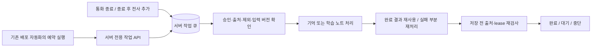

# 앱을 닫아도 이어지는 통화 후 재처리

대상은 통화 후 대화 기억과 회차 학습 노트다. 복습 탭의 UI·동작은 이 변경에 포함하지 않는다. 주간 분석도 기존 요청형 정책을 유지한다.

## 동작

`post_call_tasks`는 회차·작업 종류마다 한 행을 유지한다. 원문 본문을 큐에 복사하지 않고 사용자/회차/상대, 원문 버전, 기억 정책 revision, 처리 상태와 시도 횟수만 둔다. 종료된 통화에 실제 새 전사가 추가되면 dirty 표시로 기존 작업을 무효화한다. 버전 해시는 claim 시 계산해 발화별 전체 이력 재해싱을 피한다. 현재 코드에서 통화를 저장·종료하면 브라우저가 사라져도 큐는 남는다.

작업자는 최신 승인 상태·상대·완료된 기록·실제 사용자 발화·품질 보류·제외를 확인한다. 대화 기억에는 기존 잊기·history cutoff·서비스 억제 정책도 적용한다. 최근 30분 내 진행 중인 통화가 있는 계정은 자동 작업 시작을 미룬다. 오래 방치된 미종료 회차가 영구히 복구를 막지 않도록 범위를 제한한 것이다.

한 요청에는 작업 하나를 claim한다. `FOR UPDATE SKIP LOCKED`와 5분 lease가 동시 작업을 분리하고, 만료 후 다른 작업자가 이어받는다. 과거 작업자의 응답이나 변경된 원문으로는 새 결과를 공개할 수 없다. 학습 노트 저장 직전에 현재 큐 lease·원문 버전·승인/제외 상태를 확인하고 내부 lease 값은 공개 학습 노트에서 제거한다. 이미 저장된 기억·유효한 학습 노트는 모델 호출 없이 완료 처리한다.

## 실패별 처리

| 조건 | 처리 |
| --- | --- |
| 전송·5xx·429·불완전 출력·인용 검증 실패 | 같은 입력에서 자동 실패 최대 3회. 기본 30초·120초 대기와 작은 jitter, 유효한 Retry-After 반영 |
| 여러 부분으로 나눈 분석의 다음 부분 | 완료한 부분 재사용, 다음 요청에서 이어 처리. 정상 continuation을 실패 횟수로 세지 않음 |
| 다른 작업자가 같은 분석을 실행 중 | 기존 분석 lease를 기다림. 새 모델 호출·실패 횟수 차감 없음 |
| 요청·금액 예산 부족 | 다음 UTC 00시(한국 09시)까지 미룸. 실패 횟수로 세지 않음 |
| 인증·설정 오류 / 입력 용량 초과 | 자동 반복 중단. 운영 확인이 필요 |
| 승인 철회·제외·품질 보류·미완료 기록 | claim/저장 차단. 원문 복사나 검증 완화로 우회하지 않음 |
| 새 전사·수정·기억 정책 변경 | 기존 lease 무효화. 새 입력 버전에서 다시 판단 |
| 화면 새로고침·다른 기기·수동 재시도 | 같은 입력·생성 정책의 대기/소진 제한을 공유. 이미 완료한 분석은 재사용 |

학습 노트의 같은 요청 키가 대기·중단 상태라면 수동 요청도 무제한 재생성하지 못한다. 실제 입력이나 모델/프롬프트 정책 키가 달라지면 새 작업으로 복구할 수 있다. API 키 수정만으로 기존 소진 작업을 자동 초기화하지 않는다. 소진 작업을 검증 없이 성공으로 처리하거나 상위 모델로 자동 승격하지 않는다.

기억과 학습 노트는 서로 독립적이다. 학습 노트가 실패해도 유효한 대화 기억을 되돌리지 않는다. 기존 분석의 부분 캐시, 회차/부분별 요청 예산과 계정별 텍스트 금액 예약 한도를 유지한다. 전송 결과를 모르는 제공자 요청의 과금까지 한 번이라고 보장하지 않으며 기존 보수적 비용 예약을 유지한다.

## 예약 실행과 권한

[예약 워크플로](../.github/workflows/post-call-worker.yml)는 기본 브랜치에서 약 5분 간격의 실행을 요청하고 기본 최대 4개 작업 요청을 처리한다. 수동 실행은 1~8개 요청으로 제한한다. 예약 실행 자체는 브라우저·로그인 세션·앱 탭에 의존하지 않는다.

DB HTTP/cron 확장, 새 외부 서비스, 새 API 키나 저장소 secret을 추가하지 않는다. 기존 배포 자격으로 이 프로젝트의 기존 서버 키를 실행 중 메모리에서 가져와 자기 프로젝트의 전용 API에만 사용한다. 값이나 제공자 응답 본문은 출력하지 않는다. 서버 API는 일반 사용자 토큰·비로그인 요청·브라우저 Origin을 거부하고 요청 본문으로 처리할 계정이나 회차를 선택하게 하지 않는다. 큐 테이블과 claim/report 함수도 일반 사용자에게 공개하지 않는다.

서로 발급 시점이 다른 서버 자격이 같은 문자열이라고 가정하지 않는다. 다른 service-role JWT는 이 프로젝트의 PostgREST 서명 검증과 서비스 전용 `background_worker_authorized` 함수 권한으로 증명한다. JWT 안의 role 문자열을 읽는 것만으로 인증하지 않는다.

최근 회차의 준비 누락과 최근 7일 내 실패한 학습 노트(회차 최대 10개)를 발견해 복구한다. 모든 과거 이력을 일괄 재생성하지 않는다. 이미 유효한 결과는 재사용하므로 주기 실행이 주기 과금을 뜻하지 않는다. 회차를 삭제하면 해당 큐 행도 제거된다.

[GitHub 공식 예약 실행 문서](https://docs.github.com/en/actions/reference/workflows-and-actions/events-that-trigger-workflows#schedule)는 부하에 따른 지연·누락과 기본 브랜치 실행 조건을 설명한다. 따라서 5분 이내 완료 SLA를 주장하지 않는다. 이 저장소는 공개 저장소이므로 **저장소 활동이 60일 없으면 예약 워크플로가 자동 비활성화되는 조건**도 적용된다. 예약이 비활성화되거나 실패하면 Actions의 마지막 성공 시각·작업 상태를 확인하고, 원인을 해소한 뒤 예약을 다시 활성화하거나 수동 실행해야 한다. 별도 상시 감시·경보 서비스는 이번 변경에 추가하지 않았다. 기존 앱의 준비·복구 경로도 유지한다. 원문·개인 사실을 장애 로그나 알림에 복사하지 않는다.

## 검증 범위

실제 PostgreSQL 호환 엔진에서 영속 enqueue, 같은 입력 재시도 제한, continuation·예산 구분, 늦은 전사, 만료 lease 교체, 저장 전 출처 변경, 기존 결과 재사용, 제외·승인 철회·일반 사용자 권한을 검사한다. 서버 전용 인증과 한 요청당 작업 하나, 스케줄 실행기의 요청 수 제한·자격 비출력을 별도 검사한다. 복습 탭은 구현하지 않았으며 [사용자·정보 구조·UI 검토](research/review-definition-20261111/README.md)로 남겼다.

## 배포 및 운영 확인 — 2026-11-11

- 배포 코드 `82a2e935a618b0943181cac040f116cab3eef3fb`의 [CI 실행](https://github.com/chungchung234/English/actions/runs/42976109963)이 성공했다. 단위·통합 검사 271개, 타입 검사, 브라우저 검사, 기억 평가와 운영 설정 빌드를 통과했다.
- 운영 `coach` 함수는 `ACTIVE`, 버전 108이다. 마이그레이션 `202611110004`와 `202611110005`의 운영 체크섬이 저장소와 일치한다. 일반 학습자는 서버 권한 증명 함수를 실행할 수 없고 비로그인 사용자는 큐 작업을 claim할 수 없는 것도 운영 권한으로 확인했다.
- [서버 작업 워크플로 실행](https://github.com/chungchung234/English/actions/runs/42976361935)이 성공했고 워크플로 상태는 `active`다. 이는 예약 워크플로와 동일한 서버 경로를 **수동 실행(`workflow_dispatch`)**해 검증한 결과다. 실제 `schedule` 이벤트가 실행되는 것까지 관찰한 결과는 아니다.
- 검증 대상 작업 8개가 준비 완료됐다. 대화 기억 4개와 학습 노트 4개이며, 학습 노트 수에는 기존 결과 재사용이 포함된다. 과거 학습 분석이 실패했던 회차 1건도 현재 유효한 학습 노트가 있는 것을 확인했다. 이전 실패 이력은 그대로 보존한다.
- 확인한 학습 노트에 내부 작업 lease가 노출되지 않았으며, 운영 확인에는 작업 상태·개수·출처 일치 여부만 사용했다. 대화 원문·개인 사실은 출력하지 않았다. 실제 음성 통화에서 기억을 얼마나 자연스럽게 활용하는지나 학습 효과를 검증한 것은 아니다.

복습 화면은 이 배포에서 변경하지 않았다. 최신 외부 문구 변경을 보존한 상태에서 여섯 화면을 다시 캡처해 검토 문서에 기록했다.
