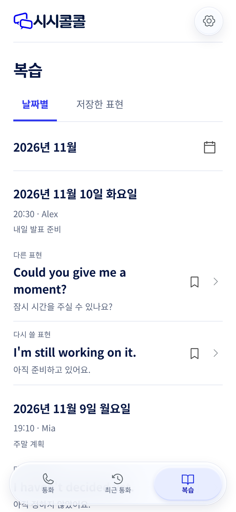
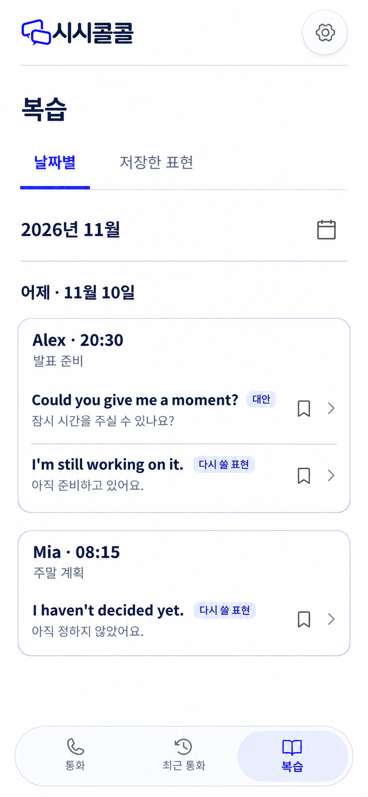
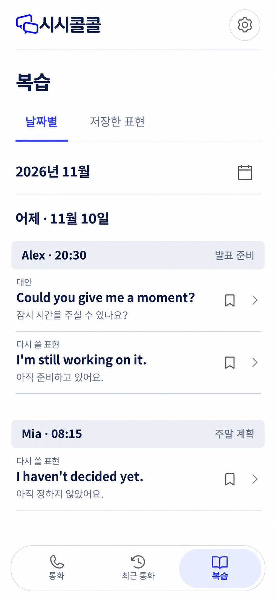
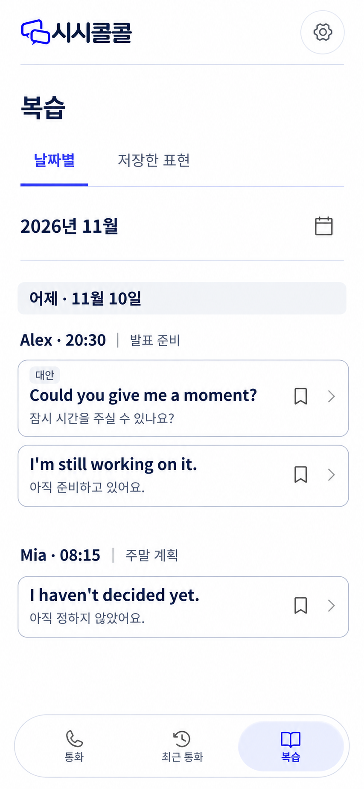

# 복습 목록의 구획과 문구 재검토

2026-11-11. 사용자는 날짜별 목록을 선택한 뒤, 구획이 불명확하고 불필요한 문구가 남았다고 지적했다. 이에 **진행 중 구현을 중단하고 시안 검토로 돌아왔다.** 중단 이후에는 디자인 문서와 이미지만 만들었다. 진행 중이던 앱·DB 변경은 배포하지 않고 별도 로컬 작업 보관에 남겼으며, 재검토 시작 시점의 앱 소스는 기준 커밋 `a19ddc0`으로 되돌렸다.

## 최종 선택과 구현 재개

이후 사용자는 수정 시안 **3번**을 선택하고 ‘어제’와 실제 날짜를 중복 표시하지 않도록 지시했다. [날짜 문구만 수정한 최종 기준](images/04-selected-final.png)을 바탕으로 구현을 재개했다. 아래 비교와 중단 기록은 당시 연구 과정이며, 현재 선택을 다시 요청하는 문서가 아니다. [구현 내용](../../review-journal-20261111.md)과 [최종 디자인 검수](../../../design-qa.md)에 결과를 기록했다.

## 검토 대상과 한계

실제 HTML/CSS를 Chromium에서 실행한 미배포 화면을 직접 열어 검토했다. 해당 화면은 합성 통화·표현 데이터를 사용했다. 운영 계정의 실제 통화 결과나 사용자 조사 결과가 아니다. 아래 수정안들은 이미지 시안이며 조작·반응형·접근성 검증을 통과한 구현 화면이 아니다.

## 관찰과 적용 원칙

| 관찰 | 문제에 대한 판단 | 시안 적용 |
| --- | --- | --- |
| 날짜·통화·표현에 비슷한 선과 간격을 사용한다 | 서로 다른 두 통화와 같은 통화의 두 표현 사이의 차이가 약하다 | 날짜는 바깥 제목, 통화는 명확한 묶음, 표현은 내부 항목으로 구별 |
| 날짜에서 연·월이 반복되고 상대와 주제가 여러 줄에 나뉜다 | 표현을 읽기 전에 훑어야 할 영역이 길어진다 | 연·월은 탐색 헤더에 한 번, 날짜와 통화 메타데이터는 간결하게 배치 |
| 타입 설명이 표현마다 한 줄을 차지한다 | 짧은 내용도 여러 줄의 안내처럼 보인다 | 의미 구분에 필요한 표식을 짧게 배치. 반복되는 ‘다시 쓸 표현’ 라벨 생략안도 비교 |
| 책갈피와 상세 진입 아이콘이 표현 오른쪽에 있다 | 어느 표현의 행동인지 소속이 분명해야 한다 | 표현 행 안에서 같은 높이·위치로 고정 |

구획을 강화하되 모든 영역을 파란 테두리·카드로 만들지 않는다. 일반 경계는 중립색, 파란색은 선택과 주 행동에 사용한다. 날짜별 탐색과 저장한 표현, 뜻, 출처는 사용자의 과제에 필요하므로 유지한다. ‘목록을 눌러 보세요’, 저장 유도 문장, 학습 방법 안내, 관리·근거·복습 예약 메뉴는 이 기본 목록에 추가하지 않는다. 교정/대안 표시는 원래 표현을 오류로 오해하지 않도록 필요한 정보다.

## 수정 시안

대화에 실제 표시된 순서가 아래 번호의 기준이다. 세 안은 동일한 날짜와 동일한 세 표현을 사용한다. 예시의 타입별 개수는 생성 규칙이나 할당량이 아니다. 통화별 상세에는 그 통화의 유효한 표현들을 함께 보여주고, 선택한 표현 위치로 이동한다는 합의는 유지한다.

| 시안 | 구획 방식 | 장점에 대한 판단 | 남는 위험 |
| --- | --- | --- | --- |
| 1 | 한 통화를 외곽선으로 묶고 내부 표현은 선으로 구분 | 통화의 소속과 시작·끝이 가장 명확하다. 통화별 학습 노트로 들어가는 구조와 잘 맞는다 | 표현이 많은 통화는 묶음이 길어질 수 있다. 테두리 색·간격은 실제 크기로 추가 검토 필요 |
| 2 | 통화 제목에 중립 배경 띠, 표현은 열린 목록 | 바깥 상자 없이도 새로운 통화 시작을 알 수 있다 | 통화의 끝은 간격에 의존한다. 긴 목록에서 소속이 약해질 가능성이 있다 |
| 3 | 표현마다 독립적인 경계, 통화 제목은 바깥에 둠 | 개별 표현과 책갈피의 소속이 명확하고 반복 라벨을 줄였다 | 표현 수만큼 상자가 늘어나며 같은 통화라는 연결이 상대적으로 약하다 |

**검토 당시 추천은 1의 통화 단위 구획이었다.** 다만 3에서 비교한 반복 라벨 생략은 별도 문구 판단으로 검토할 수 있다. 이 판단은 시각 검토와 제품 목적에 따른 권고이며 사용자 실험의 우위 결과가 아니다. 사용자가 최종 선택한 3번을 구현 기준으로 삼으며, 이 연구상의 추천으로 사용자의 선택을 대체하지 않는다.

## 새로 확인한 설계 근거

- [NN/g, Proximity Principle in Visual Design](https://www.nngroup.com/articles/gestalt-proximity/): 가까이 둔 항목은 같은 집단으로 인식된다. 통화 안의 표현 간격보다 서로 다른 통화 사이 간격을 크게 두는 근거로 사용했다.
- [NN/g, Visual Hierarchy in UX](https://www.nngroup.com/articles/visual-hierarchy-ux-definition/): 크기·색 대비·근접성과 공통 영역으로 중요도와 관계를 구별한다. 날짜·통화·표현의 위계를 정하는 설계 지침으로 사용했다.
- [NN/g, Concise, Scannable, and Objective](https://www.nngroup.com/articles/concise-scannable-and-objective-how-to-write-for-the-web/): 간결하고 훑어보기 쉬운 문장의 필요성을 검토했다. 1997년의 웹 읽기 연구이므로 논문의 개선율을 이 서비스에 적용하거나 복습 효과로 주장하지 않았다.

위 세 출처는 이번 검토에서 직접 열어 확인했다. 이 근거가 특정 테두리 굵기나 시안의 정답을 정해 주지는 않는다. 선택 후에는 실제 390px·320px 화면에서 통화 간 구분, 표현 진입과 저장의 구분, 긴 문장 줄바꿈, 키보드 포커스·큰 글자·하단 내비게이션 가림을 검증해야 한다.
