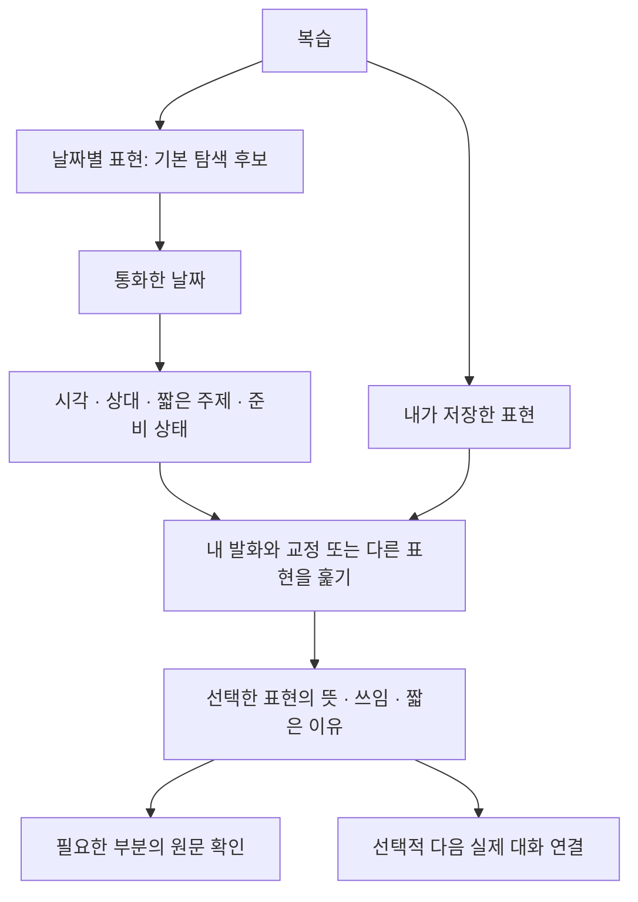
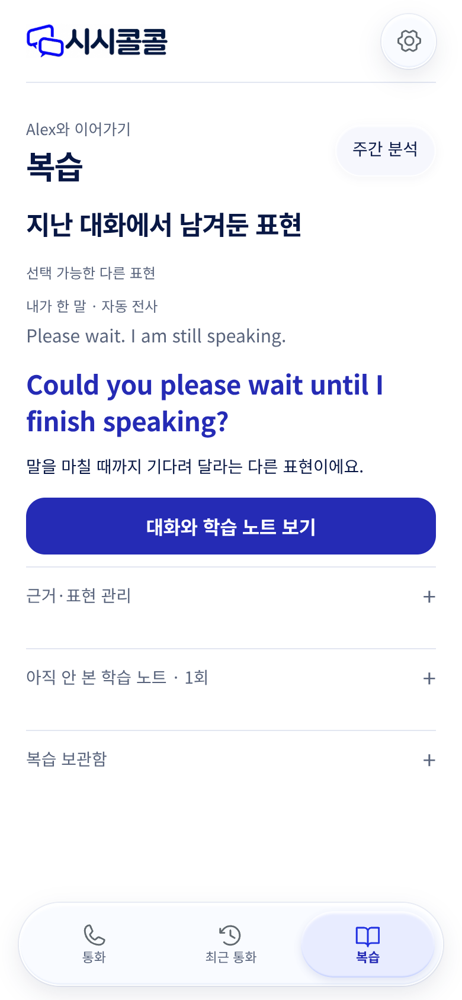
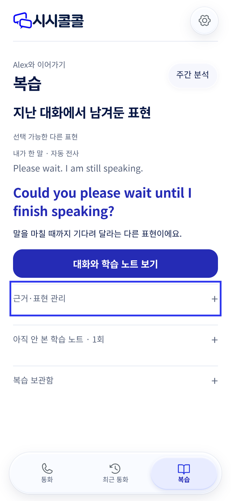
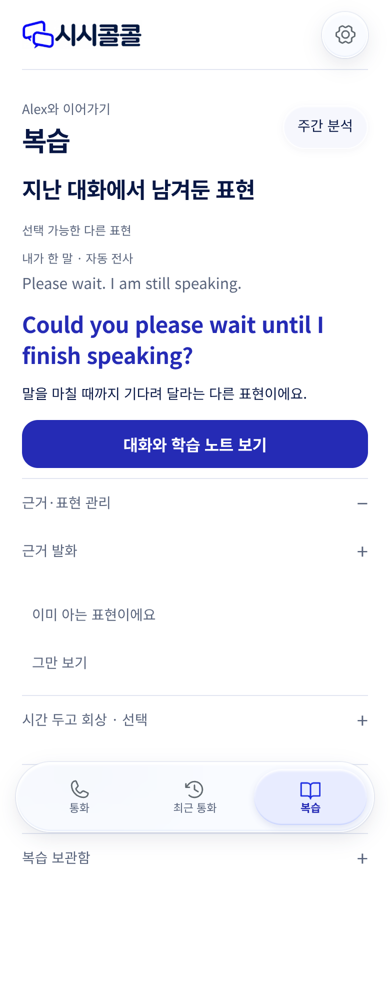
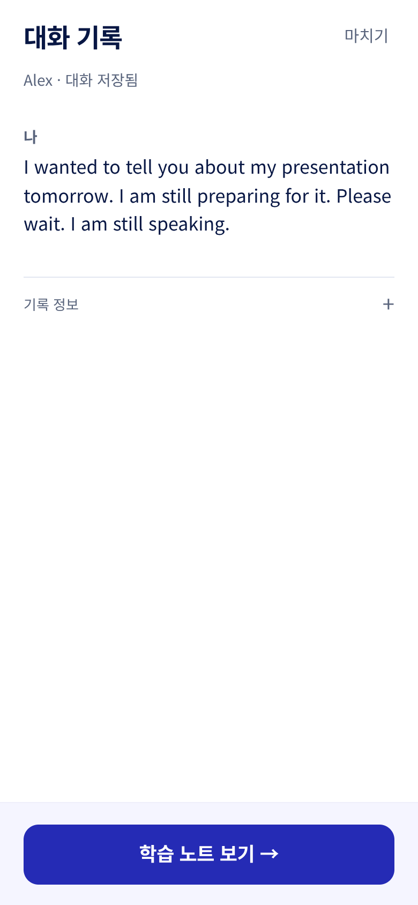
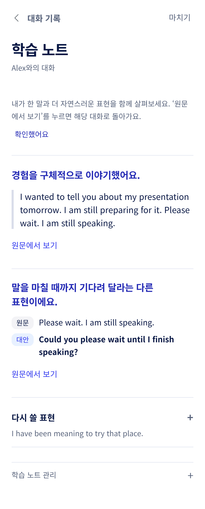
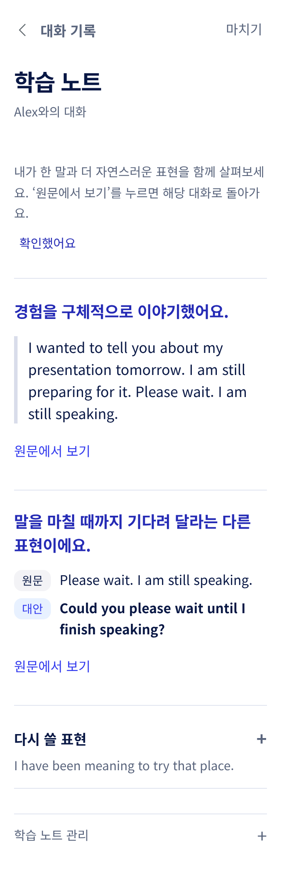

# 복습 탭의 목적·사용자·정보 구조·UI 검토

2026-11-11. **복습 화면을 구현하거나 수정하지 않은 검토 문서다.** 사용자가 제공한 두 화면과 현재 코드의 재현 화면을 근거로 삼았다. 별도 사용자 인터뷰를 수행한 결과는 아니다.

## 결론

복습은 **내가 나눈 대화에서 다시 쓰고 싶은 표현을 찾고, 뜻과 쓰임을 이해해 다음 실제 대화에서 사용할 수 있게 돕는 공간**으로 정의한다. 대화문은 자신의 뜻과 AI 제안을 확인하는 근거다. 날짜는 표현을 다시 찾는 중요한 단서이므로 기본 정리 축으로 제공할 근거가 있다. 현재의 큰 ‘대화와 학습 노트 보기’ 버튼과 여러 펼침 항목은 이 목적보다 기록 열람·관리의 비중을 높인다. 날짜별 탐색과 저장한 표현 탐색을 구분하고, 핵심 표현은 펼침 없이 훑을 수 있게 하는 방향을 권고한다. 학습 문헌은 회상·분산 연습의 가치를 뒷받침하지만 특정 버튼, 표현 개수, 복습 간격의 정답을 정해 주지는 않는다. UI는 대비 충족과 별개로 강조 순서·영역 구분·상태 표현을 다시 정리해야 한다.

## 누구를 위한 복습인가

[서비스 목적](../phone-english-purpose.md)은 한국어를 사용하는 성인이 일상·관심사를 영어로 표현하고, 상대의 말에 반응하며, 막히면 확인·수정하는 것이다. 연령대·CEFR 수준·시험 점수·사용 시간은 확인되지 않았으므로 임의로 정하지 않는다.

| 사용 상황 / 사용자 가설 | 사용자가 해결하려는 일 | 필요한 제공 | 피할 것 |
| --- | --- | --- | --- |
| 통화 직후, 자신이 말한 뜻이 전달됐는지 확인하려는 사람 | 내가 한 말과 제안의 차이 이해 | 해당 발화, 오류인지 다른 표현인지, 짧은 설명, 유용한 표현 여러 개를 선택할 여지 | 전체 기록을 처음부터 읽어야 유용한 표현을 찾는 구조 |
| 며칠 뒤 돌아와 표현을 찾는 반복 사용자 | ‘어제 Mia랑 했던 말’을 다시 찾기 | 통화한 날짜·시각·상대·짧은 대화 주제, 날짜 이동 | 표현을 정확히 기억해야 가능한 검색만 제공, ‘지난 대화’라는 모호한 출처 |
| 다시 말할 기회를 준비하는 사람 | 나에게 필요한 말을 다음 대화에 쓰기 | 저장한 표현, 뜻/사용 맥락, 선택적 다음 통화 연결 | 강제 숙제, 매번 같은 표현 수, 버튼 클릭을 숙달로 판정 |
| 소리를 내기 어려운 이동 중·공용 공간 사용자 | 읽고 골라 두고 나중에 사용 | 마이크 없는 확인·보관·다시 찾기, 선택적 조용한 회상 | 입장 즉시 녹음, 반드시 말해야 완료되는 흐름 |

이 분류는 성격을 꾸며 낸 페르소나가 아니라 사용 상황에 대한 가설이다. 현재 사용자의 피드백은 직접적인 근거 한 건이며, 전체 사용자에게 같은 문제가 얼마나 흔한지는 측정하지 않았다. 교사·운영자의 학습 관리 기능을 일반 학습자의 기본 복습 화면에 섞지 않는다.

## 현재 화면이 목적과 어긋나는 지점

| 우선순위 | 관찰 / 근거 | 사용자에게 생기는 문제 | 판단의 확실성 |
| --- | --- | --- | --- |
| P1 | 홈의 가장 큰 행동이 ‘대화와 학습 노트 보기’이고 그 다음 화면이 대화 기록이다. 사용자 첨부 1·2, 재현 1·4 | 복습의 중심 행동이 기록을 여는 일로 보임 | 화면·동작 확인. 이해도·전환율의 크기는 미측정 |
| P1 | 날짜·통화 시각 없이 표현 하나가 전면에 있고 상대는 Alex로 한정된다. 재현 1 | 어느 날 어떤 대화의 표현인지, 다른 상대의 내용을 어디서 찾는지 불명확 | 현재 상태 확인. 날짜별 보기가 필요하다는 사용자의 명시적 요청 있음 |
| P1 | 근거·표현 관리 → 근거 발화/시간 두고 회상, 아직 안 본 학습 노트, 복습 보관함이 여러 층으로 나뉜다. 재현 3 | 일반 학습 내용·탐색·드문 관리 작업을 열어 봐야 구별 가능 | 구조 확인. 사용자 클릭 수·빈도는 미측정 |
| P2 | ‘이미 아는 표현’, ‘그만 보기’, 학습 노트 확인과 회상 선택이 근처에 있다. 재현 3·5 | 읽음·보관·제외·연습·숙달을 같은 상태로 오해할 위험 | UI 문구 관찰에 따른 위험 추론 |
| P2 | 흰 본문 아래 고정 버튼 영역이 `#f5f5ff`와 별도 테두리를 사용한다. 사용자 첨부 2, 재현 4 | 의도하지 않은 별도 패널처럼 보이고 버튼과 배경이 이중으로 강조됨 | 재현·CSS 계산값 확인 |
| P2 | 펼침 행의 키보드 포커스가 각진 3px 파란 사각형으로 나타난다. 사용자 첨부 1, 재현 1·2 비교 | 일반 영역의 경계와 포커스 상태를 혼동할 수 있음 | 동일 상태 재현. 포인터 기본 상태에서는 사각형 없음 |

색을 바꾸기 전에 P1의 목적과 탐색 구조부터 정해야 한다. 펼침을 모두 없애는 것도 목표가 아니다. 핵심 학습 내용과 날짜 탐색은 보이게 하고, 전체 발화·긴 해설·드문 관리 기능에만 필요한 상세 공개를 남긴다.

## 날짜별 정리: 가능하며, 기준부터 정한다

현재 DB에는 회차의 시작·종료 시각, 상대, 원문, 분석과 출처 연결이 이미 있다. 날짜별 탐색을 위해 새로운 AI 기능이나 외부 확장을 추가할 필요는 없다. 다만 현재 화면의 최근 목록 제한과 페이지 조회 방식은 별도 설계가 필요하며, 이 문서가 날짜별 기능을 구현했다는 뜻은 아니다.

권고 기준은 **분석이 만들어진 날이 아니라 통화한 날**이다. 어제 통화의 분석을 오늘 재처리해도 어제 자료에 남아야 한다. 같은 날 여러 번 통화했다면 시각·상대별로 구분한다. 자정을 넘긴 통화는 시작 날짜에 두고 종료 시각을 함께 표시하는 규칙을 먼저 시험한다. UTC 저장값을 임의의 한국 날짜로 바꾸지 않고 표시 시간대를 적용한다. 과거 시간대를 모르는 기록에는 그 한계를 유지한다.

기본은 날짜를 훑을 수 있는 목록을 권고한다. 월간 달력 격자를 첫 화면으로 고정할 근거는 아직 없다. ‘오늘 / 어제 + 절대 날짜’, 이전 날짜로 이동, 월 이동이나 날짜 선택을 비교해 찾기 과제를 검증한다. 단순 ‘최근 7일’만으로 오래된 자료에 접근하지 못하게 해서는 안 된다.

‘전체 상대’로 내 학습 자료를 모아 보고 상대 필터를 주는 안을 권고한다. 사용자가 자신의 여러 상대 자료를 탐색하는 것과 AI 통화에 다른 캐릭터의 기억을 섞는 것은 별개다. 통화 기억의 계정·캐릭터 경계는 그대로 지킨다.

## 무엇을 어디에 제공할 것인가

| 공간 | 주된 역할 | 우선 제공 | 상세로 둘 것 |
| --- | --- | --- | --- |
| 최근 통화 | 언제 누구와 통화했는지 찾고 다시 걸기 | 일시, 상대, 기록/처리 상태, 상세·다시 걸기 | 원문 전체, 회차 정보 |
| 복습 | 내 대화에서 유용한 표현을 다시 찾고 이해하기 | 날짜·상대·주제 출처, 표현 미리보기, 저장한 표현, 처리 상태 | 긴 설명, 전체 원문, 드문 관리 작업 |
| 표현 상세 | 원문과 제안의 차이를 이해하고 다음 사용에 연결 | 내가 한 말, 교정/대안 구분, 사용할 표현, 짧은 이유, 보관 선택 | 더 많은 발화 맥락, 제외 사유 등 |
| 통화 직후의 대화 기록 | 기록이 남았는지 확인하고 원문 읽기 | 방금 기록, 실제 저장 상태, 준비된 학습 노트로 이동 | 이후 며칠 뒤 복습의 기본 정보 구조로 재사용하지 않음 |

같은 컴포넌트를 재사용한다는 구현 사정이 서로 다른 사용자 과제를 하나로 만들지는 않는다. 통화 직후에는 원문 확인이 유용하지만, 복습 탭에서 다시 방문한 사람에게 항상 원문을 먼저 열게 할 필요는 없다.

표현을 하나만 강제로 고르지 않는다. 유용한 자료는 여러 개 훑고 본인이 선택할 수 있어야 한다. 정해진 수를 채우려고 교정·표현을 생성하지도 않는다. 현재 독립적인 ‘혼자 연습’ 화면은 제거된 상태이므로, 연구를 이유로 필수 퀴즈·녹음 흐름을 되살리지 않는다. 다음 실제 대화의 재사용을 우선 연결하고, 답을 가려 떠올리는 작은 선택 기능은 필요와 부담을 확인할 별도 가설로 둔다.

## UI·색상 검토

현재 재현은 390px와 320px의 실제 HTML/CSS를 사용했다. 색상은 픽셀을 추측한 값이 아니라 계산된 CSS 값이다.

| 용도 | 현재 값 | 흰색과의 텍스트 대비 | 판단 |
| --- | --- | --- | --- |
| 큰 버튼 배경 / 흰 글자 | `#252bb5` | 10.04:1 | 가독성 문제로 단정할 수 없음. 큰 면적·다른 강조와의 우선순위 검토 필요 |
| 링크·포커스·브랜드 | `#3038ee` | 7.18:1 | 진한 버튼과 다른 토큰이 존재한다는 것 자체는 오류가 아님. 역할을 일관되게 적용 |
| 보조 문구 | `#59647c` | 5.93:1 | 측정 조합은 일반 텍스트 대비 기준을 충족 |
| 본문 | `#081744` | 17.26:1 | 본문 기본색으로 일관성 유지 권고 |
| 버튼 뒤 고정 영역 | `#f5f5ff`, 상단 `#eeeefb` | 해당 없음 | 일반 surface 토큰과 별도로 하드코딩돼 있음. 흰 본문과 다른 패널처럼 보이는 원인 |

권고는 브랜드를 새 색으로 갈아엎는 것이 아니다. 본문·선택 상태·주 행동·보조 행동·고정 영역의 의미를 정하고 기존 블루/네이비 체계에서 통일한다. 본문 제목·강조 문장·큰 버튼·선택된 내비게이션을 모두 강하게 만들지 않는다. 대안 표현을 오류처럼 위험 색으로 표시하지 않는다.

고정 버튼 영역은 같은 캔버스에 이어 보이도록 배경·안전 영역·간격을 먼저 통일하는 안을 권고한다. 구분이 필요하면 통일된 중립 경계나 그림자를 검토하고 별도 보라색 판을 추가하지 않는다. 고정 요소가 긴 원문·키보드 초점을 가리지 않는지는 스크롤·확대 상태에서 별도 검증해야 한다.

파란 사각형은 제거할 장식이 아니라 포커스 표시다. 키보드 사용자가 현재 위치를 알아볼 수 있도록 유지하면서, 행/버튼 모양과 맞는 곡률·간격·강도를 정한다. 포커스 상태를 없애서 사진만 깔끔하게 만드는 수정은 권고하지 않는다.

## 새로 확인한 외부 근거와 한계

| 근거 | 확인한 내용 / 적용 | 한계 |
| --- | --- | --- |
| [NN/g: Progressive Disclosure](https://www.nngroup.com/articles/progressive-disclosure/) | 자주 필요한 핵심 조작은 처음 보이게 하고 드문 조작을 뒤로 둔다. 현재의 학습·탐색·관리가 섞인 펼침을 역할별로 재검토할 근거 | 이 앱의 성공률을 측정한 연구가 아닌 전문가 설계 지침 |
| [NN/g: Accordions on Desktop](https://www.nngroup.com/articles/accordions-on-desktop/) | 여러 항목을 반복해서 열어 비교해야 하면 발견과 맥락 유지 비용이 커진다 | 모바일에서 아코디언을 금지한다는 근거가 아님 |
| [Karpicke & Roediger, 2008: 저자 기관 원문](https://learninglab.psych.purdue.edu/downloads/2008/2008_Karpicke_Roediger_Science.pdf) | 외국어 단어 쌍 학습에서 재인출의 지연 회상 이점을 보고. 단순 읽음과 직접 꺼내 쓰기를 구분 | AI 자유대화의 문장 전이, 특정 표현 수나 UI의 최적성을 입증하지 않음 |
| [Kim & Webb, 2022](https://doi.org/10.1111/lang.12479) | L2 분산 연습을 종합한 메타분석. 한 번 읽은 뒤 끝내지 않고 이후 사용 기회를 고려할 근거 | 여기서는 서지·공개 설명을 확인. 특정 1·3·7일 일정이나 우리 서비스의 효과를 확정하지 않음 |
| [Speak 공식 도움말: 문장·단어 저장](https://help.speak.com/en/articles/7969167-how-can-i-save-lines-and-words) | 대화 이력에서 문장·교정 표현을 골라 저장하는 역할 구분 사례 | 공식 기능 설명만 확인. 실제 앱 로그인 흐름 감사나 우월성 비교가 아님 |
| [W3C: Contrast Minimum](https://www.w3.org/WAI/WCAG22/Understanding/contrast-minimum.html) | 일반 텍스트 4.5:1 기준과 위 계산을 대조 | 일부 색상 측정으로 전체 WCAG 준수·보조기술 사용성을 주장하지 않음 |

공개 검색에서는 해당 비공개 서비스의 대표성 있는 사용자 후기 집단을 확보하지 못했다. AI 영어 앱의 커뮤니티 비교·자기 홍보 글은 다른 제품의 사례이며, 우리 서비스의 문제 빈도·대상 사용자 정의 근거로 사용하지 않았다. 기존 저장소 문헌은 맥락으로 읽었으며 이번 화면 감사의 증거 사진으로 재사용하지 않았다.

## 관찰 단계와 화면 증거

공유 브라우저 연결은 사용할 수 없어 실제 로그인 계정의 운영 화면을 직접 조작하지 못했다. 아래는 사용자 첨부 화면을 출발점으로, 현재 저장소 `b2e91c1`의 UI를 가상 인증·가상 통화/표현 데이터로 재현한 결과다. 기능 수정·시안 구현은 하지 않았다. 사진별 화면과 저장 파일을 직접 열어 확인했으며 원본 캡처를 편집하지 않았다. 전체 페이지 사진의 고정 내비게이션 위치만으로 가림 결함을 단정하지 않는다.

1. **복습 진입 — 목적·출처 표시 보완 필요.** 표현 비교는 가능하지만 일자 탐색과 재사용 행동이 전면에 없다.

   

2. **키보드 포커스 — 위치 식별은 가능, 모양의 일관성 보완.** 사용자 사진의 파란 테두리를 같은 상태로 재현했다.

   

3. **표현 관리 펼치기 — 학습·근거·관리의 위계 재정의 필요.** 펼침 안에 다시 펼침이 있고 핵심/보조 작업을 구분하기 어렵다.

   

4. **대화 기록 이동 — 기록 확인에는 적합, 복습 기본 목적과 경로 분리 필요.** 버튼 뒤 별도 고정 배경이 확인된다.

   

5. **학습 노트 — 원문/대안 비교와 출처 링크는 강점, 재방문 탐색·다음 사용 연결 보완.** 사진의 문장은 가상 예시이며 실제 학습 분석 품질의 증거가 아니다.

   

6. **320px 재배치 — 이 예시는 가로 넘침 없이 읽힘, 전체 접근성은 별도 확인.** 확대·긴 실제 데이터·스크린리더·고정 영역 가림까지 통과했다고 해석하지 않는다.

   

## 개발 전 결정과 검증

이번 단계에서 결정할 것은 ① 복습의 위 정의 ② 기본 탐색을 통화한 날짜로 둘지 ③ 내 표현을 전체 상대에서 모아 볼지 ④ 어떤 재사용 행동을 부담 없이 제공할지 ⑤ 핵심 내용과 드문 관리의 경계다. 색상 다듬기나 버튼 추가부터 시작하지 않는다.

검증은 반복 사용자와 처음 복습하는 사용자를 섞어 소규모로 시작한다. 예를 들어 반복 사용자 4명·초기 사용자 2명은 실행 가능한 시작 표본일 뿐 통계적 대표 표본이 아니다. 먼저 다음 과제를 설명 없이 수행하게 하고, 그 뒤 이유를 묻는다.

- 어제 특정 상대와 나눈 대화의 표현을 찾기. 같은 날 여러 통화가 있을 때도 구분하는지 확인.
- 내가 한 말과 AI 제안이 어떤 점에서 다른지 설명하기. 교정과 대안을 혼동하는지 확인.
- 여러 표현 중 본인이 다시 쓸 것을 고르고, 며칠 뒤 다시 찾기.
- 분석이 준비 중이거나 실패한 기록에서 원문이 남아 있다는 사실과 다음 행동을 구분하기.
- 원문 근거를 확인한 뒤 읽던 표현 위치로 돌아오기. 키보드·320px·글자 확대 조건도 포함.

실패한 경로, 되돌아감, 엉뚱한 날짜 선택, 읽음/제외/학습 상태의 오해를 기록한다. 버튼 클릭·열람 횟수를 영어 실력 향상으로 바꾸지 않는다. 지연된 새 맥락 사용은 별도로 관찰하고, 이 자료로 UI 구조를 선택한 뒤에만 시안과 구현으로 진행한다.
