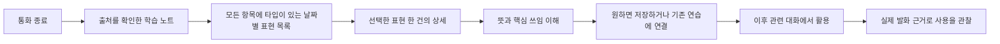

# 영어 대화 복습 고도화 기획

작성일: 2026년 11월 11일 한국 시간. 기준 소스: `67c4bc9`. 후속 지시로 수정 시안 1번을 선택했고, 모든 항목의 타입은 짧은 라벨 하나로 표시한다. 1단계 구현과 검수는 [구현 기록](review-expression-release-20261111.md)에서 추적한다. 후속 단계는 기획 범위다.

복습의 목적은 사용자가 자신의 대화에서 필요한 표현을 찾아 뜻과 쓰임을 이해하고, 이후 다른 대화에서 활용하도록 돕는 것이다. 날짜별 탐색을 유지하고, 목록의 표현 한 건이 해당 표현 한 건의 상세로 연결되도록 개선한다. 모든 표현에 타입을 표시한다. 이 두 가지는 후속 시안에 대한 사용자 지시에 따라 수정한 기준이다.

## 대상 사용자와 해결할 문제

핵심 대상은 AI와 일상·관심사·자신의 경험을 영어로 이야기하는 사용자다. 대화마다 필요한 도움은 다르므로 한 통화나 한국어 사용만으로 고정된 수준을 부여하지 않는다. 다음은 제품 설계를 위한 필요 구분이며, 사용자 조사로 확정한 집단 분류는 아니다.

| 사용자 필요 | 현재 대화에서 나타나는 문제 | 제공할 도움 |
| --- | --- | --- |
| 하고 싶은 말을 표현하기 | 단어나 문장 틀이 떠오르지 않거나 영어 표현을 직접 질문함 | 해당 의도에 맞는 어휘·회화 표현과 패턴 |
| 정확하고 적절하게 말하기 | 형태 오류가 있거나 요청·거절의 강도가 상황과 맞지 않음 | 근거 있는 교정과 상황별 대안 |
| 상대의 말을 이해하기 | 일상 구어·관용 표현의 뜻을 묻거나 재설명을 요청함 | 해당 문맥의 의미와 용례 |
| 대화를 스스로 이어가기 | 생각할 시간 확보, 되묻기, 오해 정정, 이야기 연결이 어려움 | 대화 전략과 말의 구성에 대한 도움 |

사용자는 필요한 표현 여러 개를 훑고 선택할 수 있어야 한다. 모든 대화를 숙제로 만들거나, 같은 문장을 외웠는지만 확인하는 필수 퀴즈 흐름을 추가하지 않는다.

## 현재 기능과 개선 범위

| 항목 | 기준 소스의 현재 기능 | 고도화 범위 |
| --- | --- | --- |
| 탐색 | 날짜별 여러 상대의 통화, 저장한 표현, 이전 기록 조회 | 현재 구조와 날짜 단일 표기 유지 |
| 상세 | 통화 전체 표현, 뜻·이유, 원문, 저장, 읽던 위치로 복귀 | 선택한 표현 한 건의 상세로 변경하고 주된 학습 포인트와 필요한 사용 조건 보강 |
| 분류 | `error`, `alternative`, `reusable` | 피드백 방식과 학습 내용을 분리 |
| 잘한 점 | 인용 출처를 가진 통화 단위 피드백 | 구체적으로 잘 사용한 실제 표현을 선정하고 기존 피드백과 중복 정리 |
| 표현 출처 | 분석 항목의 인용 근거는 사용자 발화 | 직접 질문을 명시적으로 연결하고, 이후 상대 발화의 표현으로 확장 |
| 일상 구어와 속어 | 별도의 체계적 선정·용례 검증 정책 없음 | 표현 성격, 문맥, 격식, 필요한 지역 정보 제공 |
| 다음 통화 활용 | 준비된 표현의 기회 제공과 사용 관찰 기능이 일부 존재 | 기존 기능을 연결하고 단순 문자열 출현과 적절한 사용을 구분 |
| 실패 복구 | 서버 작업 큐, 버전 검사, 제한된 재시도, 부분 결과 재사용 | 새 분석 형식을 기존 복구 정책에 통합 |

학습 노트의 현재 분석은 교정·대안과 연습 표현을 자원 상한 안에서 생성한다. 목록은 그 분석의 유효한 표현을 읽는다. 유형별 할당량을 만들거나 기본 목록을 추천 1~3개로 축소하지 않는다.

## 학습 내용의 정의

한 표현에 주된 학습 영역 하나를 지정한다. 다른 영역과 겹칠 때는 보조 속성으로 보관할 수 있으나 같은 표현을 여러 카드로 복제하지 않는다. 분류가 불명확한 기존 기록에는 유형을 지어 붙이지 않는다.

| 학습 영역 | 정의 | 예시 또는 제공 방식 |
| --- | --- | --- |
| 어휘와 일상 회화 표현 | 단어 의미·선택과 함께 쓰는 표현을 배움 | `make a mistake`, `hang out`, `My bad.`. 연어·구동사·관용어·일상 구어·속어를 포함 |
| 문법과 문장 구조 | 뜻을 정확하게 전달하는 형태와 구조를 배움 | `Yesterday I go…`와 `Yesterday I went…`의 핵심 차이 |
| 회화 패턴 | 내용을 바꿔 여러 상황에 쓸 수 있는 문장 틀을 배움 | `I'd rather A than B.`. 바꿀 수 있는 부분과 의미 제약을 설명 |
| 상황에 맞는 표현 | 상대·목적에 맞는 요청·거절·동의·반대 등의 강도를 배움 | 친한 사람에게 하는 부탁과 업무 상황에서의 부탁 비교 |
| 대화 전략 | 이해 실패나 말 막힘을 해결하고 대화를 주도하는 방법을 배움 | `Let me put it another way.`. 기다림·되묻기·정정·전환·종료 |
| 말의 구성 | 경험·이유·의견을 연결해 전달하는 방법을 배움 | 실제 여러 발화에서 순서·이유·결론의 연결을 설명 |

어휘와 회화 패턴의 경계는 학습 포인트로 판단한다. 고정된 결합을 익히는 `make a mistake`는 어휘·연어, 내용을 바꿔 의도를 구성하는 `I'd rather A than B`는 회화 패턴을 우선한다. 말의 구성은 단일 문장만으로 평가하지 않고 연결된 발화의 근거가 있을 때 다룬다.

듣기 이해와 발음·강세·리듬은 후속 범위다. 상대 표현의 문맥상 뜻을 설명하는 기능과, 실제 소리를 듣고 구별하거나 말하는 능력을 다루는 기능을 구분한다. 침묵이나 `okay`라는 답만으로 불이해 또는 이해 성공을 확정하지 않는다.

## 피드백 방식과 출처

| 피드백 방식 | 선정 조건 | 제외 조건 |
| --- | --- | --- |
| 교정 | 확인 가능한 영어 발화에 근거 있는 오류가 있고 원래 의도를 보존하는 수정이 가능함 | 유효한 영어의 취향 차이, 한국어 자체, 불확실한 전사 |
| 대안 | 원래 표현도 가능하며 상황에 따라 다른 선택을 제시할 실익이 있음 | 단순히 더 길고 어려운 동의어로 바꾸기 |
| 활용 제안 | 직접 질문하거나 대화에서 드러난 의도에 맞춰 새로운 표현을 제안할 이유가 있음 | 통화 주제와 무관한 추천, 유형 수를 채우기 위한 생성 |
| 잘 쓴 표현 | 사용자가 실제로 말한 표현에서 구체적인 적절성을 설명할 수 있음 | AI가 다듬은 문장을 사용자가 말한 것으로 제시하기, 일반적인 칭찬 |

‘다시 쓸 가치’는 네 방식 모두에 적용되는 선정 기준이다. 현재 `reusable`은 새 체계의 활용 제안에 대응시키되, 오래된 기록을 읽는 과정에서 뜻·학습 영역·잘 쓴 표현을 새로 추론하지 않는다.

직접 질문은 별도 상호 배타적인 타입이 아닌 학습 필요의 근거다. 질문한 발화와 제안된 표현을 연결한다. 사용자가 나중에 설명한 의도는 원래 통화 발화와 구분한다. 의도 확인·이의 제기로 보류된 항목은 기존 확인 절차를 유지한다.

각 항목의 출처는 실제 내 발화, 실제 상대 발화, 대화에 근거한 AI 제안으로 구분한다. AI 제안의 근거가 사용자 질문이라는 사실이 그 제안 문장을 사용자가 실제로 말했다는 뜻은 아니다.

## 일상 구어와 속어 선정 정책

일상 회화에서 듣고 사용할 가치가 있는 표현을 다룬다. 표현 성격은 필요에 따라 일상 구어·속어·관용어·구동사·연어·축약형으로 기록한다. 격식과 지역 정보는 표현 성격과 별개다. 구동사라고 반드시 비격식적인 것은 아니다.

| 제공 정보 | 기준 |
| --- | --- |
| 문맥상 뜻 | 통화에서 사용된 의미를 먼저 설명하고 관련 없는 사전 의미를 나열하지 않음 |
| 사용하는 상황 | 누구에게 무엇을 하려 할 때 쓰는지 필요한 조건을 짧게 설명 |
| 격식과 강도 | 친구 사이, 일반적인 대화, 업무 등 사용 판단에 필요한 경우 표시 |
| 무난한 대안 | 비격식 표현을 쓰기 어려운 상황에서 선택할 대안을 제공 |
| 지역과 유행 | 특정 지역·세대·온라인 집단에 한정된 용법은 확인된 범위만 설명 |
| 빈도 근거 | ‘자주 쓰임’ 등의 표시는 확인 가능한 회화 자료·사전의 용법 정보에 근거함 |

모델의 기억만으로 최신 유행이나 보편적 사용 빈도를 단정하지 않는다. 초기에는 용례를 확인한 표현 자료를 버전별로 관리하고, 새 후보는 확인 전까지 빈도·지역 주장 없이 문맥상 뜻을 제공한다. 참고 자료에는 출처와 확인 시점, 활용 가능한 범위를 남긴다. 화면을 열 때마다 외부 검색이나 AI 검증을 반복하지 않는다.

선정 순서는 사용자가 직접 물었거나 선택한 표현, 대화에서 이해·표현에 어려움이 확인된 표현, 주제와 연결되고 다른 대화에서도 쓸 가치가 있는 표현을 우선한다. 상대가 말한 모든 속어를 자동으로 학습 목록에 넣지 않는다.

## 표현 선정과 학습 도움

선정 전에 실제 출처, 발화자, 원문의 현재 버전, 보류·제외 상태를 검사한다. 인용이 맞더라도 언어적 판단이 옳은지는 별도로 검토한다. 의미가 달라지는 수정이나 근거가 약한 오류 주장은 공개 대상에서 제외한다.

선정 우선순위는 직접 질문·사용자 선택, 의미 전달에 준 영향, 서로 다른 통화에서 확인된 반복 필요, 사용자의 실제 주제와 목표, 다른 맥락에서의 활용 가치다. 침묵·억양·한국어 사용으로 능력 수준을 추정하지 않는다. 반복 문제라고 설명할 때는 서로 다른 날짜의 발화 근거가 필요하다.

유형별 최소 개수는 없으며 아무 표현도 선정하지 않는 결과가 가능하다. 생성 비용의 상한은 유지하고, 유효한 결과를 목록에서 임의로 처음 몇 개만 남기지 않는다. 통화 내 중복은 합치되 서로 다른 통화의 맥락과 사용 이력은 보존한다.

| 학습 영역 | 상세에서 필요한 도움 | 이후 활용의 목표 |
| --- | --- | --- |
| 어휘와 일상 회화 표현 | 문맥상 뜻, 함께 쓰는 말, 필요한 사용 조건 | 다른 경험에서도 같은 표현을 사용할 수 있음 |
| 문법과 문장 구조 | 원문과 수정의 핵심 차이, 뜻과의 관계 | 다른 내용에서도 해당 구조를 선택할 수 있음 |
| 회화 패턴 | 바꿀 수 있는 부분과 짧은 예시 | 자신의 내용으로 패턴을 구성할 수 있음 |
| 상황에 맞는 표현 | 상대·목적에 따른 선택 이유 | 상황에 맞게 표현의 강도를 조절할 수 있음 |
| 대화 전략 | 언제 사용할지와 그다음 이어갈 행동 | 막혔을 때 대화를 복구하거나 주도할 수 있음 |
| 말의 구성 | 실제 발화에서 연결이 필요한 부분 | 순서·이유·의견을 자신의 말로 연결할 수 있음 |

예시는 설명용이며 정답 문장을 강제로 반복하게 하지 않는다. 기본 목록 열람·저장과 연습 등록은 별도 행동으로 유지한다.

## 화면과 사용자 흐름

현재 선택한 3안의 표현별 경계, 날짜만 표시하는 제목, 브랜드 색과 내비게이션을 유지한다. 날짜별 목록과 저장한 표현에서 선택한 표현 한 건의 상세로 들어간다. 상세에는 해당 표현의 뜻·실제 발화 또는 질문·쓰임·사용 예·대안과 행동만 둔다. 같은 통화의 다른 표현이나 통화 전체 강점을 이어 붙이지 않는다. 사용 예와 대안은 선택한 항목을 설명하는 내용이며 별도 추천 카드로 제시하지 않는다.

모든 목록 항목에 같은 위치·같은 시각 문법으로 짧은 타입 하나를 표시한다. ‘교정’, ‘대안’, ‘잘 쓴 표현’은 피드백 구분을 우선하며, 활용 제안에는 ‘일상 구어’, ‘속어’, ‘구동사’, ‘패턴’ 등 확인된 주된 성격을 표시한다. 학습 영역이 없는 과거 활용 제안은 ‘표현’으로 표시한다. 두 부분으로 된 라벨과 여러 색의 배지를 나열하지 않는다. 상세의 타입은 선택한 목록 항목과 동일하다. 피드백 방식과 세부 학습 영역은 내부 데이터에서 구분하며 과거 기록의 학습 영역은 임의로 추론하지 않는다.

상세의 주 제목은 선택한 영어 표현이다. 상대·날짜·시각은 출처 메타데이터로 둔다. 상황·격식·패턴 설명은 해당 항목에 필요할 때만 나타난다. 표현별로 일괄적인 긴 양식을 채우지 않는다. 저장은 해당 표현 한 건에 적용하며, ‘대화에서 보기’는 관련 발화에 초점을 맞춘 별도 원문 경로다. 원문에서 상세로, 상세에서 목록으로 돌아갈 때 기존 탭·날짜·스크롤·초점을 복구한다. 이전 항목의 지연 응답이 새 상세를 바꾸지 않게 한다. 원문 변경·삭제·보류로 해당 표현이 무효해지면 다른 표현으로 자동 대체하지 않고 상태와 복귀 경로를 제공한다.

예를 들어 `I did a mistake`가 확인되면 `I made a mistake`를 어휘·연어의 교정으로 제공한다. 다른 경험에 이 표현을 쓸 수 있도록 돕는다. `I'm down`은 실제 초대에 동의하는 맥락일 때 그 뜻과 편한 말이라는 조건을 설명한다. 실제 상대 발화에서 가져오는 경우는 후속 단계에서 출처 지원을 추가한 뒤 제공한다. 이 예시들은 가상 사례다.

## 데이터와 생성 구조

다음은 구현 시 사용할 논리 항목이다. 기존 DB 열 이름이나 확정된 API 규격은 아니다.

| 항목 | 역할 |
| --- | --- |
| 피드백 방식 | 교정·대안·활용 제안·잘 쓴 표현 |
| 주된 학습 영역 | 여섯 학습 영역 중 해당 항목의 핵심 |
| 표현 성격 | 필요한 경우 연어·구동사·관용어·일상 구어·속어·축약형 |
| 표현과 문맥상 뜻 | 사용자에게 보여줄 영어와 간결한 한국어 설명 |
| 원문과 출처 | 회차·실제 발화자·발화 ID·인용·원문 버전 |
| 직접 질문의 근거 | 해당 사용자 질문과의 연결 |
| 사용 도움 | 핵심 이유와 필요한 상황·격식·패턴·대안 |
| 생성 및 분류 버전 | 기존 결과와 새로운 생성 정책의 호환·재처리 판단 |

개별 상세의 식별 기준은 회차와 표현 키를 함께 사용한다. 화면이 전체 통화 자료를 받더라도 현재 유효한 선택 항목만 상세에 투영하며, 다른 표현을 연속 렌더링하지 않는다. 기존 통화 전체 학습 노트 접근과 개별 표현 상세는 별도 경로로 구분한다.

통화 후 분석에서 필요한 정보를 함께 생성하고 검증해 저장한다. 복습 방문·날짜 이동·저장마다 AI를 호출하지 않는다. 중간 요약은 대화 연결이라는 기존 목적을 유지하며 복습용 분류·번역을 추가로 요구하지 않는다.

사용자 발화만을 인용 근거로 허용하는 현재 검증을 상대 발화 기능 때문에 전체적으로 완화하지 않는다. 후속 단계에서 상대 발화의 표현은 별도 발화자 검증을 추가하고, 그 근거로 사용자의 오류나 성공을 주장할 수 없게 한다.

기존 노트는 그대로 읽을 수 있게 하고, 누락된 학습 영역은 생략한다. 모든 과거 통화를 일괄 재생성하지 않는다. 새 형식은 새 통화부터 적용하고, 기존 정책에 따른 명시적 재처리에서는 새 분석 버전과 출처를 검증한다. 저장 포인터는 같은 표현에 안정적으로 연결하고, 문장이 달라졌다면 근거 없이 다른 표현에 자동 이관하지 않는다.

기존 서버 큐·부분 결과 재사용·요청 예산·재시도 제한을 사용한다. 재시도마다 같은 표현이 누적되거나, 검증 실패를 없애기 위해 출처 기준을 낮추면 안 된다. 학습 노트 실패가 유효한 캐릭터 기억을 되돌리지 않도록 현재 작업 분리를 유지한다.

전체 상대의 표현 탐색과 캐릭터별 통화 기억은 구분한다. 저장·열람이 다른 캐릭터의 기억을 자동으로 바꾸지 않는다.

## 개발 단계와 완료 기준

| 단계 | 범위 | 완료 기준 |
| --- | --- | --- |
| 1 표현 선정과 설명 개선 | 여섯 학습 영역, 네 피드백 방식, 직접 질문 연결, 잘 쓴 표현, 검증한 일상 구어·속어, 표현 한 건의 상세와 모든 항목의 타입 | 아래 품질 사례를 검토하고 기존 노트·저장·출처·계정 경계를 보존. 수정 시안과 실제 화면을 대조 |
| 2 상대 표현과 활용 연결 | 사용자가 뜻을 묻거나 선택한 실제 상대 표현, 문맥상 의미 설명, 기존 다음 통화 활용 기능과 연결 | 발화자 혼동 없이 원문을 찾을 수 있고 통화를 강제 연습으로 바꾸지 않음. 문자열 출현만으로 학습 성공을 표시하지 않음 |
| 3 음성 기반 학습 | 필요한 음성 구간을 듣고 구별하기, 발음·강세·리듬 도움 | 음성 이용·보관 범위와 실제 음성 검증 방식을 먼저 설계. 이해 가능성을 목표로 하고 원어민 억양 모사를 일괄 정답으로 삼지 않음 |

1단계는 새로운 탭·학습 관리 화면·외부 서비스·강제 퀴즈를 추가하지 않고 기존 분석과 상세를 개선하는 범위다. 2단계는 이미 있는 활용 기회·관찰 경로를 확장한다. 개발 기간은 각 단계의 실제 변경 범위와 평가 결과를 확인해 산정한다.

## 품질 검증과 효과 관찰

| 필수 검토 사례 | 기대 결과 |
| --- | --- |
| 맞는 영어와 문법 오류의 최소 차이 | 유효한 표현을 오류로 만들지 않고 필요한 교정만 제공 |
| 한국어 질문·혼합 언어·의도 설명 | 한국어를 영어 문법 오류로 처리하지 않고 실제 발화와 후속 설명을 구분 |
| 전사 이의·중도 저장·원문 수정 | 보류와 버전 검사를 지켜 무효한 교정을 공개하지 않음 |
| 직접 물어본 표현과 같은 뜻의 중복 항목 | 질문과 답을 연결하고 같은 표현 카드를 중복 생성하지 않음 |
| 유형별 0개·여러 개와 빈 통화 | 할당량 없이 근거 있는 항목만 제공 |
| 표현 A·B·C가 있는 목록에서 B 선택 | B 한 건의 상세와 동일한 타입만 표시. A·C는 상세에 나타나지 않음 |
| 날짜별 목록과 저장 목록의 모든 항목 | 타입 누락 없이 같은 위치에 표시. 과거 기록의 미확인 학습 영역은 생성하지 않음 |
| 상세 간 이동·원문 복귀·선택 항목 무효화 | 지연 응답 혼입 없이 선택을 유지하고 목록 위치를 복구. 다른 항목으로 자동 대체하지 않음 |
| 잘 쓴 표현과 AI 제안이 비슷한 경우 | 실제 사용자 인용만 잘 쓴 표현으로 표시 |
| 속어의 다의성·격식·지역·유행 차이 | 실제 문맥에 맞는 의미와 검증된 사용 조건만 제시 |
| 대화 전략·말의 구성 | 관련된 발화 맥락에 근거해 설명하고 단어 하나로 능력을 평가하지 않음 |
| 과거 노트·재처리·저장·계정 전환 | 기존 기록을 읽고 저장 상태와 사용자 경계를 보존 |
| 모바일 320px·큰 글자·키보드 | 표현과 행동이 잘리지 않고 초점·읽던 위치가 복원됨 |

형식·인용·권한·상태 전이는 자동 검사하고, 오류 여부·의도 보존·표현의 적절성은 영어 교육 관점의 사례 검토를 병행한다. 출시를 막는 중대한 사례는 사용자 발화 조작, 다른 계정 출처, 유효한 문장의 명백한 오교정, 잘못된 의미·사용 조건, 보류된 자료의 재노출이다. 같은 평가 사례에서 기존 분석과 새 분석을 비교해 개선과 회귀를 확인한다.

제품 품질은 잘못된 교정·의미 변형·중복 추천·누락된 직접 질문, 표현을 찾고 뜻과 쓰임을 설명할 수 있는지로 본다. 학습 효과는 동의한 사용자와 실제 대화에서 시간이 지난 뒤 도움 없이 꺼내는지, 다른 상황에 적절하게 쓰는지, 오해를 복구하는지로 관찰한다. 저장률·열람률·통화 시간은 이용 지표로 따로 둔다. 목표 수치는 현재 기준값과 평가 자료를 확보한 뒤 정하며 임의의 향상률을 약속하지 않는다.

## 관련 근거와 기존 기능

- [현재 날짜별 복습과 배포 기록](review-journal-20261111.md)
- [선택한 3안과 디자인 검토](research/review-boundaries-20261111/README.md)
- [개별 표현 상세와 전체 타입 표시를 반영한 수정 시안](design/review-learning-upgrade-20261111/README.md)
- [전화 영어의 목적과 상호작용](research/phone-english-purpose.md)
- [학습 목표와 평가 기준](research/standards-outcomes-review.md)
- [교정과 지연 재사용 연구](research/feedback-retention-review.md)
- [현재 통화 후 재처리 정책](post-call-reprocessing-20261111.md)

CEFR의 상호작용·대화 전략과 Nation의 의미 중심 입력·출력, 언어 학습, 유창성 원칙을 참고한다. 위 여섯 영역과 단계 구분은 이 서비스의 설계안이며 해당 기준이 직접 규정한 분류나 이 앱의 학습효과 검증 결과는 아니다.
